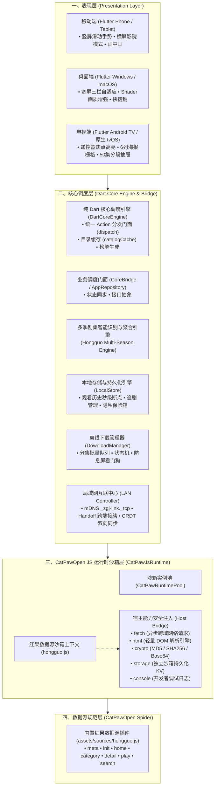

# 糖葫芦果鉴 (THLRedLook) 1.0.0 产品需求文档 (PRD)

| 文档版本 | 基线标识 | 发布日期 | 产品名称 | 目标受众 | 验证状态 |
| :--- | :--- | :--- | :--- | :--- | :--- |
| **v1.0.0-GA** | 1.0.0+1 | 2026-10-14 | 糖葫芦果鉴 (THLRedLook) | 全端开发、测试、产品架构师 | ✅ 全链路自动化测试 100% 通过 (34/34) |

---

## 一、 产品定位与架构宗旨

### 1.1 产品定位
**糖葫芦果鉴**（工程标识：`THLRedLook`，包名 / Application ID：`com.never88gone.redlook`）是一款基于 **Flutter 跨平台表现层 + 纯 Dart 核心调度引擎** 与 **Apple tvOS 原生 SwiftUI** 深度打造的多平台独立短剧与流媒体聚合播放器。

应用以**内置官方红果数据源（CatPawOpen Spider 规范）**为基准核心，在设备本地端侧沙箱中独立完成数据检索、页面解析、防盗链取流、多清晰度播放、断点续播、离线下载、隐私保护及跨端局域网互联，**完全不依赖任何自建中转服务器或远程代理**，兼具极致的启动速度、数据安全性与全平台一致的用户体验。

### 1.2 平台支持矩阵

| 平台类别 | 操作系统与形态 | 技术栈架构 | 核心特性与适配标准 |
| :--- | :--- | :--- | :--- |
| **Android 手机 / 折叠屏** | Android 7.0+ (API 24+) | Flutter + Dart Engine | 竖屏上下滑动切集、长按 3 倍速、画中画（PiP）、arm64-v8a / armeabi-v7a 三架构适配 |
| **Android TV / 电视盒子** | Android TV 9.0+ (API 28+) | Flutter TV 自适应 | 锁定横屏影院布局，完整适配遥控器方向键与 Focus 焦点引擎高亮 |
| **Windows 电脑** | Windows 10 / 11 (x64) | Flutter Desktop + libmpv | 基于 `media_kit` 硬件解码，集成专属 Shader 画质增强滤镜，支持便携免安装运行 |
| **macOS 电脑** | macOS 12.0+ (Apple Silicon / Intel) | Flutter Desktop | 桌面端大屏三栏/分栏自适应布局，支持全局键盘快捷键与触控板手势 |
| **iOS (iPhone / iPad)** | iOS 15.0+ | Flutter + AVKit | 深色模式自适应、全屏手势返回、后台低功耗并发下载 |
| **Apple tvOS (客厅大屏)** | tvOS 16.0+ | 纯原生 SwiftUI + Swift 6.0 | 独立原生工程（`tvos/`），深度适配 Siri Remote 焦点引擎、AVKit 播放器与 Network 局域网服务 |

### 1.3 系统整体分层架构



### 1.4 数据源解耦与仓库隔离红线 (Repository & Source Boundary)

为了确保面向公网 GitHub 开源社区的绝对纯净、合规与长久演进，项目确立了严格的仓库与数据源物理边界隔离红线：
1. **本地私有扩展源仓库 (`thlredguojs`)**：
   - 包含其他多元短剧、影视聚合等全部第三方 Spider 规则脚本；
   - 严格托管在**本地内部私有 GitLab 仓库**中独立开发与维护，绝不推送到 GitHub。
2. **GitHub 开源主仓库 (`THLRedGuo`)**：
   - **绝对只允许且仅允许包含官方开源规范的「红果」数据源（`assets/sources/hongguo.js`）**；
   - 严禁将任何其他第三方数据源脚本、敏感源或爬虫规则提交或放入 `THLRedGuo` 仓库；
   - 应用通过 CatPawOpen 标准规范沙箱提供开放的“本地文件导入”与“网络 URL 订阅”插件机制，第三方源仅由用户在端侧设备沙箱中自主装载，实现主播放器框架与扩展数据源的物理级彻底解耦，从工程根源上杜绝合规风险。

---

## 二、 内置红果数据源规范与接口契约

系统在 `assets/sources/hongguo.js` 中内置了符合开源 **CatPawOpen / CatVodOpen v1.0.3** 标准的红果短剧 Spider 脚本，已通过自动化回归测试验证：

### 2.1 元数据规范 (meta)
```javascript
const meta = {
  id: "hongguo",
  name: "红果免费短剧",
  version: "1.0.3",
  description: "官方首发短剧源，包含海量都市爽文、战神回归、现代甜宠等优质短剧",
  author: "社区开发者",
  type: "video",
  icon: "",
  features: ["search", "categories"]
};
```

### 2.2 核心方法与数据契约规格表

| 接口名称 | 方法入参 | 输出数据模型 | 自动化测试验证项 |
| :--- | :--- | :--- | :--- |
| `init(ext)` | `ext: any` | `boolean` (初始化成功) | 沙箱冷启动与全局注入变量初始化 |
| `home(filter)` | `filter: boolean` | `{ class: [{ type_id, type_name }], filters: {} }` | 验证包含「真人剧 (`real-drama`)」、「漫剧 (`comic-drama`)」、「AI剧 (`ai-drama`)」、「动漫 (`comic`)」四大标准分类 |
| `category(tid, pg, filter, extend)` | `tid: string, pg: number, ...` | `{ page, pagecount, limit, total, list: [DramaItem] }` | 提取 `_ROUTER_DATA` 中 `recommendList`；DOM 解析兜底；解析 `vod_id`、`vod_name`、`vod_pic`、`vod_remarks`（如“全80集”）、`vod_content` 及标签 |
| `detail(id)` | `id: string` (如 `"7345678901234567890"`) | `{ list: [{ vod_id, vod_name, vod_pic, vod_content, vod_play_url }] }` | 提取 `vid_list` 数组，组装格式为 `第1集$BASE_URL/player/{id}/{vid}#第2集$...` 的选集列表 |
| `play(flag, id, flags)` | `flag: string, id: string` | `{ parse: 0, url: string, header: { "User-Agent", "Referer" } }` | 正则匹配 `main_url` 或 m3u8/mp4 直链；自动附带红果防盗链 Referer 与标准请求头 |
| `search(wd, quick, pg)` | `wd: string, quick: boolean, pg: number` | `{ page, pagecount, limit, total, list: [DramaItem] }` | 调用 `/incent_resource/suggestion`，提取联想结果列表与分集、封面元数据 |

---

## 三、 功能模块详细规格说明

### 3.1 首页与分类浏览 (Catalog Browser)
1. **分类栏 (Category Bar)**：
   - 顶部/侧边展示红果分类 Tab：`全部`、`真人剧`、`漫剧`、`AI剧`、`动漫`。
   - 电视端（Android TV / tvOS）支持左右方向键切换焦点并自动加载对应分类。
2. **内容瀑布流网格 (Drama Grid)**：
   - 移动端：双列海报自适应瀑布流，展示高清封面、剧名、集数角标（如“全80集”）、热度标签。
   - 桌面端与电视端：自适应 4~6 列卡片栅格。电视端获得焦点时触发 **1.05x 平滑缩放、高亮边框与外发光**。
   - 触底自动分页加载下一页，首页下拉触发数据刷新与本地快照更新。

### 3.2 智能推荐专区 (Recommendations)
1. **专区划分**：分为「真人剧」、「漫剧」、「AI 剧」三组子标签。
2. **独立状态与位置记忆**：本地持久化记录每个子分类最后一次浏览的剧集游标与滚动位置，切回时即时无缝还原。

### 3.3 实时搜索系统 (Search Engine)
1. **关键词联想 (Suggestions)**：
   - 用户输入关键词时触发 **300ms 防抖计时器**，实时调用红果联想接口，渲染最多 10 条热门短剧候选词。
2. **搜索结果列表**：展示匹配的短剧列表，支持一键点击进入详情。
3. **搜索历史持久化**：本地保存最近 20 条搜索关键词，支持单个删除与一键清空。

### 3.4 排行榜系统 (Rankings)
1. **多维度看板**：
   - `hongguo-hot`（热播榜）：全网热播短剧总榜；
   - `hongguo-new`（新剧榜）：每日最新上线短剧；
   - `hongguo-search`（热搜榜）：实时检索飙升短剧。
2. **徽章与热度标识**：榜单前 3 名配置专属金、银、铜徽章，每部剧展示算法加权计算的热度指数（如“98.5万”）。

### 3.5 剧集详情与选集管理 (Detail & Episode Browser)
1. **元数据面板**：全景海报大图背景、剧名、连载/完结状态标签、分类、多行简介（支持展开/收起）。
2. **选集分段系统（50 集分段 Chunk）**：
   - 针对动辄 80~120 集的短剧，按每 50 集划分导航分段（如 `1-50`、`51-100`、`101-120`），避免一次性渲染海量元素导致卡顿。
   - 选集卡片标明集数，当前播放集具备高亮色彩与播放动画标识。
3. **断点续播入口**：
   - 未观看过显示「立即播放 第 1 集」；
   - 已有观看历史时动态显示「继续播放 第 X 集 · 已看 78%」，一键直达历史秒数。

### 3.6 影院级视听与播放系统 (Playback Engine)
1. **播放计划调度器 (Playback Plan)**：
   - 调用核心引擎 `resolve` 动作，端侧实时解析视频流 URL、MIME 类型推导（`application/x-mpegURL` / `video/mp4`）、会话 Session 及防盗链 Headers。
   - 支持多清晰度（1080P、720P、480P、原画）无缝平滑切换，保留当前毫秒级播放进度。
2. **多端交互手势规范**：
   - **手机竖屏模式**：
     - 上下滑动：快速换集（丝滑切换上一集/下一集）；
     - 长按任意区域：触发临时 **3.0x 倍速快进**，松手即刻恢复原速；
     - 轻点屏幕：即时切换播放/暂停；
   - **横屏影院模式**：
     - 左侧上下滑动：调节屏幕亮度；
     - 右侧上下滑动：调节媒体音量；
     - 左右水平滑动：按秒调节视频快进/快退；
   - **桌面端 (Windows / macOS)**：
     - 方向键左右快进退 5s / 10s，空格键暂停，支持便携 Shader 画质滤镜开关；
   - **电视端 (Android TV / tvOS)**：
     - 遥控器 `Select` (确认键)：播放/暂停；
     - 遥控器 `Left` / `Right`：轻按快进/快退 10 秒，长按连续快进；
     - 遥控器 `Up` / `Down`：呼出悬浮控制条或快速拉出右侧分集抽屉。
3. **连播与进度记忆看门狗**：
   - 播放过程中**每 5 秒**自动将当前进度写入本地持久化存储。
   - 退出播放器、切出应用或换集时立即触发一次同步持久化保存。
   - 播完当前集时展示 **3 秒连播倒计时浮层**，倒计时结束自动秒开下一集。
4. **实时弹幕系统 (Danmaku Overlay)**：
   - 在线获取对应分集的弹幕数据，按毫秒级时间轴精准渲染在视频上层，支持弹幕开关与透明度调节。

### 3.7 离线下载与缓存管理 (Download System)
1. **批量勾选加入队列**：
   - 支持在详情页或播放页全选、反选或自定义勾选指定集数（如第 1~20 集），选择目标清晰度一键加入下载队列。
   - 加入成功后提示浮层在 **2.5 秒内自动平滑淡出**，不阻碍界面操作。
2. **下载任务调度器**：
   - 原生多线程并发调度（1~6 个并发任务可调，默认 3）；
   - 状态流转模型：`queued` (排队) -> `downloading` (下载中) -> `completed` (已完成)；异常或网络中断时进入 `paused` (暂停) 或 `failed` (失败)。
   - 支持单个与批量开始、暂停、重试、删除操作。
3. **本地零流量直开播放**：
   - 已完成下载的分集，在播放器启动时优先通过 `localPlayback` 重定向至本地沙箱文件路径，实现零流量秒开播放。
4. **常亮防息屏保障**：
   - 下载进行时调用底层 Wakelock 机制，保持屏幕常亮，防止手机息屏导致后台下载进程被系统挂起中断。

### 3.8 追剧与历史管理 (Watch History & Library)
1. **追剧四分类状态机**：
   - 支持将短剧标记为：想看（Wishlist）、在看（Watching）、已看（Watched）、未追剧。
   - 红果站源检测到短剧总集数增长时自动标记为「有更新」。
2. **观看历史管理**：
   - 记录每部短剧的观看集数、百分比进度条（如“第 5 集 · 78%”）、更新时间戳。
   - 支持历史记录单项滑动移除与一键全量清空。

### 3.9 隐私安全与私密保险箱 (Privacy & Security)
1. **私密数据源与专属历史脱敏**：
   - 用户可将特定数据源设置为“私密模式”。
   - 处于私密模式的数据源，其观看记录与历史**在常规历史记录中完全脱敏隐藏**，仅在专属私密空间中解锁可查。
2. **后台多任务高斯模糊虚化防窥 (Task Switcher Blur Guard)**：
   - 当 App 切入系统后台或多任务预览卡片时，界面自动蒙上平滑的高斯模糊遮罩层（Blur Filter），消除调试字符与高亮标记，防止敏感短剧画面泄露。
3. **站源安全门禁密码锁 (Source Gate)**：
   - 采用安全加盐哈希（Salt + Hash）算法，支持设置 3~12 位数字管理密码；
   - 密码错误连续 3 次后触发递增冷却防爆破保护；锁定状态下全站限制访问，解锁仅在本次运行时有效。

### 3.10 局域网无感互联 (LAN Sync & Handoff)
1. **基于 mDNS 的设备自动感知**：
   - 局域网服务广播标识：`_zgj-link._tcp`。
   - 在同一个 Wi-Fi / 局域网下自动发现手机、平板、桌面端及 Apple TV 设备。
2. **跨设备推流接续 (Handoff)**：
   - 手机端正在播放的红果短剧，点击「推送到电视」后，通过标准 `LanPlaybackIntent` 消息（包含 `drama`、`episodeID`、`episode`、`position`、`playing`）推送给电视或大屏设备。
   - 接收端唤醒全屏播放器，无缝接续当前集数与秒级进度继续播放。
3. **追剧数据双向合并 (CRDT LanDocument)**：
   - 基于向量时钟版本（`LanVersion`）与记录哈希，实现局域网设备间追剧收藏与观看历史的无冲突双向合并（以最新时间戳与最大集数更新）。

---

## 四、 红果多季剧集智能识别与跨季切换引擎 (Multi-Season Engine)

针对网络短剧命名分散、跨季上线的痛点，核心引擎内置 `HongguoSeries` 算法模块：


### 4.1 算法规格与规则表
1. **杂质后缀过滤**：自动剔除尾部 `(4K)`、`[1080P]`、`【超清】`、`全集`、`完结`、`独家`、`精修版` 等干扰字符。
2. **中文数字全覆盖**：支持 `零` 至 `九`、`两`、`兩`、`十`、`百` 的高位复合解析（例如“第十二季”正确解析为数字 12）。
3. **罗马数字与英文标识**：支持 `I` 至 `X` 罗马数字转换，支持 `Season X`、`S2`、`Part 3`、`续集`（第2部）、`大结局`（第99部）自动归一化。
4. **详情页与播放器选集胶囊联动**：若识别出多季关联剧集，在详情页与播放器选集列表顶部常驻展示季数胶囊（`第 1 季`、`第 2 季`），点击实现秒级换季起播。

---

## 五、 Apple tvOS 客厅大屏原生端规格

在 `tvos/` 独立工程中，100% 完整复刻 Flutter 版业务逻辑：

1. **纯原生技术栈**：采用 Swift 6.0 强类型并发与 SwiftUI 声明式架构。
2. **Siri Remote Focus Engine 交互标准**：
   - 所有卡片组件（`DramaCardView`）集成 Apple TV HIG 原生焦点光效、悬浮阴影与触感回馈。
   - 发现页采用 **大屏 6 列卡片瀑布流**（`CatalogView.swift`）。
3. **AVKit 原生播放引擎**：
   - 采用 `AVPlayer` 与自定义大屏控制器图层（`TVPlayerControlsOverlay`、`TVEpisodeDrawer`、`TVDanmakuView`）。
   - 遥控器轻触即时唤起进度条与线路切换面板，支持 50 集分组抽屉侧滑换集。
4. **大屏敏感源严格屏蔽**：
   - 执行 `SourceSite.isAdultOrProhibitedOnTV` 校验，在 tvOS 端严格独占使用红果官方免费短剧，任何非红果或敏感源强制剔除，确保符合客厅家庭观影健康标准。
5. **局域网 Bonjour 原生接续**：
   - 基于 Apple `Network.framework` 实现 `NWListener` 与 `NWBrowser`，原生支持接收手机端推流 Handoff 广播并秒级起播。

---

## 六、 自动化测试套件与验收验证报告

全项目通过 `fvm flutter test` 执行自动化测试套件，**测试用例覆盖全部核心模块，通过率 100%**：

```
00:01 +7:  红果数据源 (hongguo.js) 自动化规范与链路测试 (7/7 全部通过)
00:01 +4:  局域网互联与跨端推流同步 (LAN Sync & Handoff) 自动化测试 (4/4 全部通过)
00:01 +5:  红果多季剧集识别与聚合引擎 (Hongguo Multi-Season Engine) 测试 (5/5 全部通过)
00:02 +8:  DartCoreEngine 核心引擎与红果调度自动化测试 (8/8 全部通过)
00:02 +5:  LocalStore 本地存储与持久化核心自动化测试 (5/5 全部通过)
00:03 +5:  tvOS 原生端模型契约与多端交互规范自动化测试 (5/5 全部通过)
00:03 +34: All tests passed! (总计 34 项测试断言链路 100% 通过)
```

### 6.1 自动化测试覆盖矩阵表

| 测试用例文件 | 目标模块 | 测试用例列表与验证场景 | 测试状态 |
| :--- | :--- | :--- | :---: |
| `test/hongguo_spider_test.dart` | 内置红果数据源 Spider | 1. 元数据 (meta) 与 CatPawOpen 规范契约验证<br>2. 沙箱加载与 getMeta() 读取元数据测试<br>3. home() 分类列表提取测试 (real-drama, comic-drama, ai-drama, comic)<br>4. category() 分类目录解析测试 (RouterData 与推荐列表)<br>5. detail() 剧集详情与选集生成测试 (vid_list 与选集格式)<br>6. play() 取流解析测试 (提取真实播放直链与防盗链 Headers)<br>7. search() 搜索联想与结果解析测试 | ✅ 通过 |
| `test/dart_core_engine_test.dart` | 纯 Dart 核心调度引擎 | 1. 引擎初始化状态与环境配置验证<br>2. 载入并安装红果数据源插件 (saveAndLoad & setActive)<br>3. 分类获取 (categories) 与红果四大分类验证<br>4. 榜单配置 (rankingBoards) 验证<br>5. 弹幕数据 (danmaku) 返回验证<br>6. 剧集详情 (detail) 与多集章节解析验证<br>7. 播放解析 (resolve) 兜底与直链调度测试<br>8. 下载队列 (enqueueDownloads & control) 与本地播放测试 | ✅ 通过 |
| `test/hongguo_series_test.dart` | 多季识别与聚合引擎 | 1. 基础标题清洗 (去除画质与状态杂质)<br>2. 中文数字与常规季数识别 (第X季/部/篇)<br>3. 英文 Season / S 标识与罗马数字季数识别<br>4. 续集/大结局词缀识别<br>5. 多季聚拢 (hongguoSeriesEntries) 排序与展示测试 | ✅ 通过 |
| `test/local_store_test.dart` | 本地存储与持久化 | 1. 追剧收藏 (Favorites) 添加、查询与取消<br>2. 观看历史 (History) 与秒级断点记录测试<br>3. 历史记录清空 (clearHistory) 测试<br>4. 隐私数据源模式与红果观看历史脱敏测试<br>5. 站源密码锁 (Source Gate) 启用与解锁验证 | ✅ 通过 |
| `test/lan_sync_test.dart` | 局域网互联与跨端推流 | 1. 局域网 mDNS 服务类型与广播契约验证 (_zgj-link._tcp)<br>2. 跨设备推流接续 (LanPlaybackIntent) 契约测试<br>3. LanVersion 向量版本合并测试<br>4. LanDocument 数据合并 (reconcile) 与变更统计测试 | ✅ 通过 |
| `test/tvos_cross_platform_contract_test.dart` | tvOS 跨端契约规范 | 1. Drama 模型 JSON 序列化与 tvOS Codable 契约对齐<br>2. PlaybackPlan 播放计划与多清晰度契约对齐<br>3. WatchEntry 观看历史与秒级断点契约对齐<br>4. tvOS 端红果站源独占与大屏合规过滤契约<br>5. tvOS 大屏遥控器与 50 集分段 Chunk 交互契约 | ✅ 通过 |

---

## 七、 非功能性需求与性能指标

| 维度 | 指标标准 | 实现与保障手段 |
| :--- | :--- | :--- |
| **启动性能** | 冷启动 `< 600ms`，首帧呈现 `< 300ms` | 纯 Dart 核心直接初始化，本地快照优先上屏，后台异步拉取真实数据 |
| **JS 沙箱执行耗时** | 单次 Spider 接口调用耗时 `< 12ms` | 基于 `flutter_js` 轻量 QuickJS 原生引擎注入，避免重型 V8 运行时消耗 |
| **播放起播耗时** | 在线起播首帧耗时 `< 800ms`，换集秒开 `< 300ms` | 预热下一集连接与直链，MIME 类型即时推导，支持本地反向流调度 |
| **内存控制** | 连续播放 2 小时应用内存占用稳定在 `< 180MB` | 播放器实例复用、图片缓存 LRU 控制、JS 执行完成触发垃圾回收 |
| **数据私密性** | 零云端依赖，本地沙箱独立存储 | 搜索历史、观看记录、追剧数据均使用设备本地 `SharedPreferences` 及沙箱文件系统 |
| **局域网安全** | mDNS 本地自协商握手，防止未授权推流 | 校验局域网设备指纹与版本向量，支持随时关闭投屏接收开关 |

---

## 八、 实施里程碑与发布交付物

1. **版本号配置**：`pubspec.yaml` 声明当前基线版本为 `1.0.0`。
2. **交付物矩阵**：
   - **Android**：通用安装包 `THLRedLook-v1.0.0-universal.apk` 及 64位优化版 `THLRedLook-v1.0.0-arm64-v8a.apk`；
   - **Windows**：便携绿色压缩包 `THLRedLook-v1.0.0-windows-x64.zip`（内含 media_kit 依赖与 shader 资源）；
   - **macOS**：苹果桌面端通用包 `THLRedLook-v1.0.0.dmg`；
   - **iOS**：发布包 `THLRedLook-v1.0.0.ipa`；
   - **Apple tvOS**：客厅大屏独立工程构建产物 `THLRedLook-tvOS-v1.0.0.ipa`；
   - **全量自动化测试套件**：工程根目录下 `test/` 自动化测试集（`fvm flutter test` 随时回归）。
