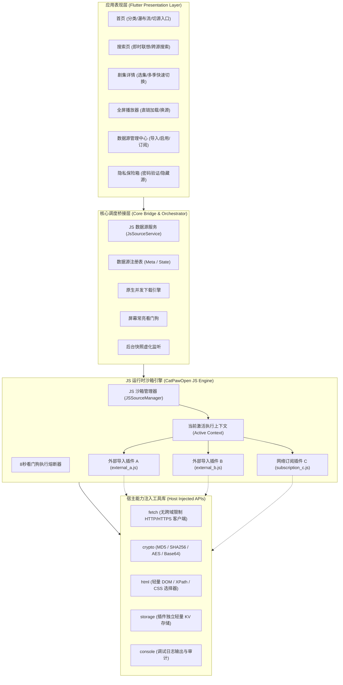
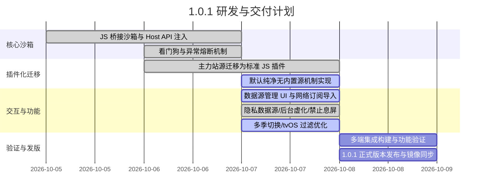

# 糖葫芦果鉴 (THLRedLook) 1.0.1 产品需求文档 (PRD)

| 文档版本 | 发布日期 | 产品名称 | 目标受众 | 规划状态 |
| :--- | :--- | :--- | :--- | :--- |
| **v1.0.1-正式版** | 2026-10-07 | 糖葫芦果鉴 (THLRedLook) | 产品、研发、架构、测试 | 规划完成 / 实施中 |

---

## 1. 版本概述与背景动机

### 1.1 现状与重构动机
在 1.0.0 版本中，应用通过底层核心引擎实现了全平台的短剧聚合与流媒体播放闭环。然而，原架构存在明显的痛点：
1. **源站变动维护成本极高**：站源解析逻辑全部硬编码于客户端代码中，任何一个源站的 API 变更或页面结构微调，都需要全量发版客户端。
2. **多源耦合，缺乏容错隔离**：多站源处于同一运行空间，某一个源的死循环或网络超时容易造成全局阻塞。
3. **用户生态扩展受限**：无法实现类似现代内容聚合工具（如阅读、TVBox、CatVod、海阔视界）的规则可定制化与社区自治能力。
4. **合规与分发考量**：官方应用打包如果内置敏感或不稳定第三方站点，会给应用分发与上架带来极大合规风险。

### 1.2 1.0.1 核心目标
1. **站源彻底插件化（JavaScript 驱动）**：将所有站源的列表检索、分类获取、搜索联想、详情提取、直链解析完全抽象为独立的 JavaScript (`.js`) 脚本文件。
2. **切换数据源本质即切换 JS 文件**：应用层统一调度，用户切换数据源即是沙箱内切换执行当前的 JS 规则脚本，完全解耦。
3. **出厂默认纯净（默认无任何内置数据源）**：应用安装启动后，出厂不预置任何预设数据源，保持纯粹的空播放器框架形态，由用户自主配置、导入或订阅插件。
4. **沙箱隔离与故障容错**：每个 JS 插件在独立的沙箱上下文环境中执行，互不干扰；具备看门狗超时中断机制，单个插件异常不影响全局。
5. **体验与安全性升级**：
   - 数据源隐私模式（特定源需输入密码才能切换访问，其观看历史在最近播放中完全脱敏隐匿）。
   - App 切入系统后台时的多任务页面虚化防窥（无刺眼下划线，纯净高斯模糊）。
   - 离线下载防息屏控制（设置中支持“禁止锁屏”常亮）。
   - 下载任务浮层优化（加入下载后提示自动消失，不常驻底部阻挡操作）。
   - 多季短剧/剧集快捷关联与跨季无缝切换。
   - 大屏端（tvOS）敏感内容与 18 禁内容严格过滤屏蔽。

---

## 2. 系统整体架构设计



---

## 3. 标准 JS 数据源协议规范 (v1.0.1 协议)

每一个数据源为单独的 `.js` 脚本文件，必须导出全局 `source` 对象，或声明顶层标准函数与 `meta` 元数据对象。

### 3.1 元数据规范 (meta)
```javascript
const meta = {
  id: "hongguo",                  // 唯一英文代号 (字母/数字/下划线)
  name: "红果免费短剧",             // 界面展示名称
  version: "1.0.1",               // 插件语义化版本
  author: "社区开发者",            // 作者信息
  description: "全网热播短剧聚合",   // 描述介绍
  type: "video",                  // 插件类别 (video / anime / drama)
  icon: "https://...",            // 图标 URL (可选)
  features: ["search", "categories", "suggestions"], // 支持的能力特性
  requiresPassword: false,        // 是否需要隐私密码验证 (由用户或插件标记)
  is18Plus: false                 // 是否属于成人/敏感内容 (tvOS 端强制剔除)
};
```

### 3.2 生命周期与标准接口定义

| 接口名称 | 参数列表 | 返回值说明 | 必备/可选 |
| :--- | :--- | :--- | :--- |
| `getCategories()` | 无 | `Array<{ id: string, name: string }>` 分类列表 | 必备 |
| `getCatalog(category, page, pageSize)` | `category: string, page: number, pageSize: number` | `{ items: Array<DramaItem>, hasMore: boolean }` 目录列表 | 必备 |
| `search(query, page)` | `query: string, page: number` | `Array<DramaItem>` 搜索结果列表 | 必备 |
| `getSuggestions(query)` | `query: string` | `Array<string>` 搜索建议词数组 | 可选 |
| `getDetail(id)` | `id: string` | `DramaDetail` 对象（含剧集与多季信息） | 必备 |
| `getPlayUrl(episodeId, extra)` | `episodeId: string, extra?: any` | `{ url: string, type: 'hls'\|'mp4', headers?: object }` | 必备 |

### 3.3 数据结构契约
- **DramaItem 结构**：
  ```json
  {
    "id": "1001",
    "title": "剧集标题",
    "cover": "https://img.example.com/cover.jpg",
    "desc": "简介或更新状态",
    "tags": ["都市", "热血"]
  }
  ```
- **DramaDetail 结构**：
  ```json
  {
    "id": "1001",
    "title": "剧集标题",
    "cover": "https://img.example.com/cover.jpg",
    "desc": "全集详细描述",
    "seasons": [
      { "id": "1001_s1", "name": "第 1 季" },
      { "id": "1001_s2", "name": "第 2 季" }
    ],
    "episodes": [
      {
        "id": "ep_1",
        "title": "第 1 集",
        "index": 1,
        "url": "https://.../play/1.html"
      }
    ]
  }
  ```

---

## 4. 宿主环境注入能力 (Host Bridge APIs)

沙箱宿主为每个 JS 插件执行环境注入全局工具，插件自身无需引入庞大的 npm 打包依赖：

1. **`fetch(url, options)`**：
   - 跨平台原生 HTTP 客户端，绕过浏览器 CORS 跨域限制。
   - 支持自定义 `headers`（`User-Agent`、`Referer`、`Cookie` 等）。
   - 响应对象包含：`status`、`headers`、`body`（文本内容）、`json()`、`text()`。
2. **`crypto`**：
   - 原生高性能加解密算法库，提供 `md5(str)`、`sha256(str)`、`base64Encode(str)`、`base64Decode(str)`。
3. **`html`**：
   - 嵌入式轻量 DOM 解析引擎，提供 `html.parse(htmlString)`。
   - 返回 jQuery 链式风格节点包装：`find()`、`first()`、`last()`、`eq(index)`、`attr(name)`、`text()`、`html()`。
4. **`storage`**：
   - 插件私有持久化轻量 KV 存储：`get(key)`、`set(key, val)`、`remove(key)`。各插件存储彼此严格物理隔离。
5. **`console`**：
   - 调试日志管道：`console.log()`、`console.warn()`、`console.error()`，自动投递至客户端“插件开发者调试日志窗口”。

---

## 5. 详细功能需求与用户故事

### 5.1 纯净模式与默认无数据源
- **出厂状态**：首次安装或清空缓存启动时，`_builtinAssets` 为空，应用不预装任何数据源脚本。
- **空白态引导**：
  - 首页及分类页面展示优雅的空白插画与引导卡片：“当前未添加数据源插件”。
  - 提供两个显著操作按钮：【从本地导入 .js】、【添加网络订阅链接】。
- **切换与保存**：
  - 用户导入至少 1 个插件后，系统自动激活首个有效插件，并持久化到本地偏好中。

### 5.2 数据源管理中心 (Settings -> JS 插件管理)
- **插件列表展示**：卡片式展示已安装插件（名称、版本、作者、标识 ID、特性标签）。
- **一键切换**：点击卡片右侧“激活/切换”，系统无感将当前执行上下文置换为该插件，首页即刻刷新。
- **动态导入机制**：
  - **本地文件选择器**：支持系统文件选择器（`.js` 规则文件）。
  - **剪贴板/文本粘贴**：支持直接粘贴 JS 源码快速调试。
  - **网络 URL 订阅**：输入远程 URL，自动拉取并保存到应用的专属插件目录下。
- **插件停用与删除**：支持单个插件物理删除；当前正在激活的插件若被删除，自动优雅回退到剩余插件或进入空态。

### 5.3 隐私安全保护
- **私密数据源加锁**：
  - 用户可在插件管理中将特定源标记为“隐私源”。
  - 切换到隐私源时，弹出系统级 6 位密码/生物识别认证弹窗；认证未通过拒绝切换。
  - **播放历史脱敏**：最近观看历史列表中，属于隐私源的播放记录默认完全隐藏；仅当用户解锁进入“隐私保险箱”后方可查阅。
- **后台多任务模糊虚化**：
  - 当 App 退到多任务后台时，界面自动蒙上平滑的高斯模糊遮罩层（Blur Filter）。
  - 移除多任务快照中任何调试文案与下划线标记，杜绝敏感内容在多任务卡片预览中泄露。

### 5.4 播放与下载体验升级
- **设置中新增“禁止锁屏”常亮功能**：
  - 设置页面提供【禁止休眠锁屏】开关（默认在下载或播放进行时开启）。
  - 开启后调用底层 Wakelock 机制，避免长时间大批量短剧下载时手机熄屏导致后台线程被系统挂起中断。
- **下载任务提示优化**：
  - 当点击“批量下载全集”时，底部提示浮层（如“已加入26集，已有任务自动跳过”）展示持续 2.5 秒后自动平滑淡出，不再长驻遮挡界面底部操作栏。
- **多季短剧快捷切换**：
  - 针对分多季上线的长线剧集，在详情页选集面板顶部增加【第 1 季】、【第 2 季】标签选择器，实现秒级切季，告别孤立剧集无法联动问题。
- **tvOS 大屏合规过滤**：
  - 针对大屏电视端客厅场景，严格读取 `meta.is18Plus` 标志，在 Apple tvOS 平台完全屏蔽成人或敏感分类榜单。

---

## 6. 非功能性需求与性能指标

| 维度 | 指标要求 | 实现与保障措施 |
| :--- | :--- | :--- |
| **沙箱启动性能** | 单个 JS 引擎冷启动 `< 15ms` | 基于轻量 goja / QuickJS 引擎，无重型 V8 运行时开销。 |
| **执行看门狗** | 单次调用超时阈值 `8000ms` (8秒) | 独立 Goroutine/线程看门狗监控；超时强制中断并通知 UI 降级提示。 |
| **内存与隔离** | 单个沙箱内存占用 `< 4MB` | 上下文独立，运行完毕自动触发引擎 GC，禁止跨沙箱对象共享。 |
| **安装包增量** | 全平台包体积增量 `< 2.5MB` | 纯 Native 嵌入引擎，不引入庞大 Node.js 环境或 Chromium 依赖。 |
| **多端兼容性** | 6 大平台 100% 运行一致性 | Android、Windows、macOS、iOS、Android TV、tvOS 共享核心沙箱协议。 |

---

## 7. 实施里程碑规划 (Milestones)



---

## 8. 验收标准与测试用例 (Acceptance Criteria)

1. **纯净安装验收**：全新安装或清空缓存启动 App，首页必须展示“未安装数据源”空白态，没有任何未经许可的默认站源。
2. **插件导入验收**：
   - 导入本地合法 `.js` 文件后，能够正确解析出 `meta.name`、`meta.version` 并展示在列表中。
   - 非法或语法错误脚本导入时弹出明确错误提示，不产生崩溃。
3. **切源体验验收**：在设置或首页切源面板中切换不同数据源，分类列表、瀑布流目录、搜索及详情选集能在 500ms 内平滑更新。
4. **沙箱隔离验收**：故意在某个 JS 脚本中编写死循环（`while(true){}`），看门狗在 8 秒后自动打断并抛出友好超时提醒，应用主线程保持 60fps 丝滑流畅。
5. **隐私功能验收**：
   - 标记隐私源后切换必须校验密码；未输入密码无法访问该源任何数据。
   - 隐私源播放的记录不展示在常规“最近播放”列表中。
   - 进入多任务后台界面时，屏幕截屏被有效虚化，无调试字符与黄色下划线。
6. **息屏与下载验收**：勾选“禁止锁屏”后，开始多集批量下载，放置 10 分钟设备保持屏幕常亮且下载顺利完成；下载加入提示在 3 秒内自动淡出消失。
