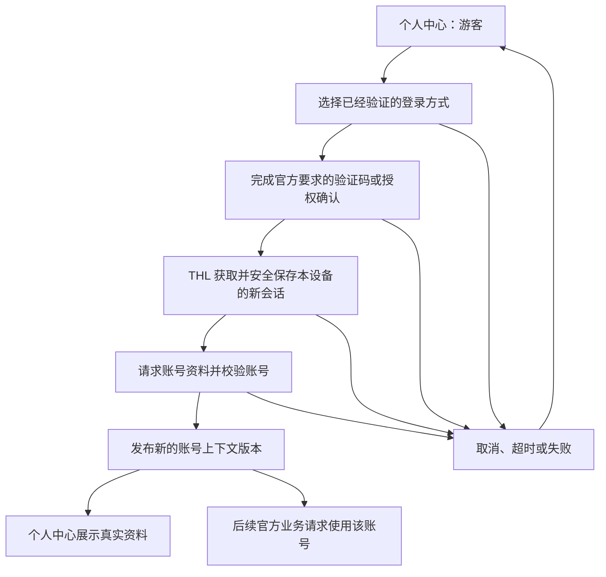

# THLRedGuo 登录与个人中心 PRD

| 项目 | 内容 |
| --- | --- |
| 文档状态 | v0.2，需求草案；已核对扫码候选链路，登录能力尚未实现、尚未验收 |
| 编写日期 | 2026-11-02 |
| 开发分支 | `dev`，从当前 `main` 基线创建 |
| 应用版本 | 保持 `1.0.0`，不因本需求修改版本及既有构建配置 |
| 覆盖平台 | Flutter Android、Windows、iOS、macOS、Android TV；原生 tvOS |
| 本轮交付 | PRD、现状核对与 APK 登录接口静态盘点；本轮不实现登录页面或账号请求 |

## 1. 背景与目标

当前应用使用红果官方 JS 数据源和设备游客会话，支持浏览、搜索、推荐、取流、弹幕及本地追剧、历史。现有“用户管理”用于 THL 本地资料隔离，并非红果官方账号登录。

本需求恢复官方账号能力的开发：继续参考官方 APK，打通用户主动授权的登录流程，新增个人中心。登录后，所有红果官方业务 API 请求均使用当前账号的有效会话，覆盖页面浏览和播放器内部请求，避免首页显示已登录、搜索或下一集仍使用游客身份。

用户不需要持有或导入 APK，不需要手工复制 Cookie、Token 或配置。APK 仅作为协议研究参照。登录为可选功能，游客继续使用已经可用的浏览和播放能力。

登录旨在接入账号资料和官方账号数据，不作为解决全部 HTTP 200 空正文、海外网络限制或播放故障的保证。此前已有官方 APK 匿名连播成功的证据，不能将所有匿名取流失败归因为“必须登录”。

### 1.1 成功标准

1. 至少一种真实登录方式完成登录、校验账号、重启恢复和退出闭环，不能仅保存用户 ID 后宣称登录成功。
2. 已登录状态下，统一请求层对全部适用的官方业务请求使用同一个账号上下文，签名与最终请求内容一致。
3. 个人中心能区分游客、已登录、登录失效、离线待确认，展示真实资料和对应操作。
4. 登录、退出、切换账号及本地用户时，不串用凭据、缓存、预加载结果和同步任务，不丢失本地收藏、历史及播放进度。
5. 官方收藏、点赞、历史、预约按真实接口逐项接入；未接通的功能明确标注，不用本地列表冒充官方同步结果。

## 2. 已知现状与证据边界

| 项目 | 已确认事实 | 对需求的影响 |
| --- | --- | --- |
| 游客身份 | Flutter 的 `HongguoGuestSession` 持久化设备游客信息；tvOS 有独立的 JS 与游客会话管理 | 新增账号会话，不将设备会话直接当作账号凭据，不通过反复注册游客解决登录问题 |
| 请求参数 | 当前 `hongguo.js` 搜索建议等请求中存在固定的 `user_is_login: 0` | 需要盘点全部入口，按真实登录状态生成参数，不能只给取流接口加 Cookie |
| 本地用户 | `ProfilesScreen` 和本地资料存储提供用户切换、权限及备份能力 | 账号绑定到当前本地用户，个人中心不能与本地用户管理混为一谈 |
| 数据保存 | 已有本地收藏、历史、进度和部分平台 iCloud 同步 | 官方账号数据单独建模，保持现有本地资料及删除墓碑语义 |
| 研究 APK | 本机已有官方 APK `7.4.3.32`，文件哈希与既有来源记录一致 | 作为本轮研究基线；不将该历史样本表述为当前最新版 |
| 账号入口 | 本轮静态扫描发现短信、授权、账号资料、退出等路径及登录文案 | 仅证明 APK 包含相关实现线索，不证明入口已启用或 THL 已能调用 |
| 红果 App 扫码 | APK 有官方网页扫码确认入口；公开 Passport SDK 有申请、轮询方法；本轮最小申请返回业务错误 `16`、“该应用无权限” | 优先研究红果官方 App 扫码；目前没有签发可用二维码，不能开放为已实现功能 |
| 抖音扫码 | 此前移动应用配置申请二维码遭服务器拒绝；APK 内有抖音 OAuth 二维码路径 | 与红果 App 扫码分开验证，不将其他 App 的二维码或授权结果视为红果观看账号会话 |

### 2.1 本轮发现的 APK 静态路径线索

下表只列待追踪的路径，不预设请求域名、参数、签名字段、返回凭据或实际调用顺序。通用 SDK 内的路径不等于红果当前实际启用的登录方式。

| 能力 | 静态发现的路径示例 | 后续必须证明的内容 |
| --- | --- | --- |
| 登录策略 | `/passport/general/login_guiding_strategy/` | 当前设备允许哪些登录方式，入口如何受服务端配置控制 |
| 短信验证码 | `/passport/mobile/send_code/v1/`、`/passport/mobile/check_code/`、`/passport/mobile/sms_login/` | 区号、验证码类型、风控校验、设备绑定、实际登录凭据和错误处理 |
| 抖音相关授权 | `/passport/can_aweme_quick_login/`、`/passport/auth/login/`、`/passport/auth/get_oauth_token/v2/` | 官方 App 实际使用的授权链、回调校验及第三方授权到红果账号的兑换关系 |
| 二维码手机确认 | `/passport/open/scan_qrcode/`、`/passport/mobile/confirm_qrcode/` | 核对手机扫描端的用途与限制，不能将确认接口当作二维码申请接口 |
| 账号资料 | `/passport/account/info/`、`/passport/account/info/v2/`、`/reading/user/basic_info/get/v` | 账号有效性判定、资料字段、用户 ID 类型和展示边界 |
| 会话维护 | `/passport/token/beat/v2/` | 此路径是否用于当前登录方式；不能直接将“心跳”视为刷新 Token 接口 |
| 退出 | `/passport/user/logout/` | 退出作用范围、设备绑定及服务端失效语义 |

本轮扫描没有登录用户账号，没有发送验证码，没有复制 Android 运行时 Cookie、Token 或签名凭据。静态盘点产物保存在已忽略的 `build/verification/login-prd-20261102`。

### 2.2 红果官方 App 扫码的候选链路

以下来自 APK 调用链和官方部署的网页组件，属于协议研究依据，不代表 THL 已完成接入。

| 环节 | 已找到的方法或行为 | 已知限制 |
| --- | --- | --- |
| 等待登录端申请 | Passport Web SDK 的 `getQrcode` 使用 GET `/passport/web/get_qrcode/`，传入 `next` 及附加参数 | 需要服务端接受对应应用与请求配置；路径存在不等于红果应用已获准使用 |
| 等待登录端查询 | `checkQrconnect` 使用 GET `/passport/web/check_qrconnect/`，传入同次申请的 `token`、`next` 及附加参数 | 尚未拿到有效申请结果，未进入真实轮询；状态值、有效期、频率和最终会话签发均待确认 |
| 红果 App 识别 | APK 的扫码配置默认识别 `changdunovel.com`、`reading.snssdk.com` 的 `/ucenter_web/app/sdk-next` 页面 | 配置可由服务端更新；仅证明存在手机端处理入口 |
| 手机端确认 | 官方 `scan-auth` 组件调用 POST `/passport/mobile/scan_qrcode/` 与 POST `/passport/mobile/confirm_qrcode/` | 从扫码链接取得临时 `token`；扫描响应的 `confirmed_url` 提供确认所需的 `csrf_token`、`csrf_ts`，不能自行伪造确认 |
| 开放平台授权 | SDK 另有 POST `/passport/open/get_qrcode/`、POST `/passport/open/check_qrcode/`，APK 有创作者中心专用扫描处理 | 依赖对应的 `client_key`、授权范围及场景；不能借用创作者配置作为 THL 的观看账号登录 |

官方公开脚本依据：[Passport Web SDK](https://lf-serial-static.fanqienovel.com/obj/novel-serial-cdn/toutiao/novel_fe/serial_common_vmok/static/js/async/153.7a5d227e12.js)、[手机扫码确认组件](https://lf-ucenter-web.yhgfb-cn-static.com/obj/passport-fe/ucenter_fe/@byted/uc-scan-auth-application/1.0.13/dist/index.umd.production.pure.js)。它们是共享组件，不能单凭其中的方法断言红果当前已经启用全部能力。

一次受控的未登录申请以 APK 的应用 ID `8662`、已知 Passport 域名和官方消费者首页作为 `next`，向 `/passport/web/get_qrcode/` 发出请求。服务端返回 HTTP 200，但正文为 `message: error`、`error_code: 16`、`description: 该应用无权限`，未签发二维码。该请求不是已捕获的红果官方网页完整请求；这一结果证明本次最小配置不可用，尚不能区分应用能力限制、必要配置缺失或其他服务端校验，不能据此断言该能力永远不可用。

研究只使用本次探测新建的内存 Cookie 容器，没有扫描、确认、发送验证码或登录账号；未保存临时票据、二维码内容和 Cookie 值，也未获取或解码二维码图片。

官方创作者网站当前页面与调用方代码只启用手机号、密码登录。共享组件虽然有 `qrcode` 枚举和标题，但当前登录组件没有对应的二维码内容或轮询实现，不能当作可用扫码入口。官网的 App 下载二维码同样不能当作登录二维码。

接入前还必须证明：合法申请能够成功；红果官方 App 能识别并完成用户确认；THL 自己的等待会话能取得服务端签发的登录态；账号资料与红果观看账号一致；会话能用于对应的官方业务 API。申请失败时停止本次流程，展示真实业务错误；不继续无效轮询、不生成替代二维码、不更换为其他产品的应用 ID 或客户端配置。

## 3. 需求范围与阶段

| 优先级 | 内容 | 交付要求 |
| --- | --- | --- |
| P0 | APK 登录链、有效会话识别与维护 | 先在参照环境确认真实行为，再实现 THL 自己的登录流程；形成按平台区分的能力表 |
| P0 | 全部官方业务 API 的账号上下文 | 所有请求入口统一接入，包含预加载、分页、重试、连续下一集和清晰度切换 |
| P0 | 个人中心 | 登录、账号资料、会话状态、退出、本地功能入口和错误反馈完整可用 |
| P0 | 资料与凭据隔离 | 账号、本地用户、游客及 JS 运行环境之间不串用数据；退出后不被迟到响应重新登录 |
| P1 | 官方收藏、点赞、历史和预约同步 | 属于本 PRD 总体范围，分接口完成真实读写和验收，不能在登录完成时一并宣称已实现 |
| P1 | 跨设备友好的登录交互 | 优先验证扫码；仅在协议支持时提供手机辅助操作，保证电视端无需冗长输入 |
| 后续 | 编辑官方资料、绑定或解绑账号、账号注销、支付与会员操作 | 本次不实施；不展示不可用或未经验证的操作入口 |

平台实施顺序为：对照 Android APK 确认协议，完成 Flutter Android 与 Windows 核心流程，再复用到 iOS、macOS，并实现原生 tvOS 及 Android TV 的适配。总体验收按平台分别记录，不能以某一端成功代替其他平台验收。

## 4. 登录方案与用户流程

### 4.1 登录方式的开放规则

1. 只有在 APK 实际调用链与 THL 端完整登录闭环均通过验证后，才将对应方式开放给用户。
2. 优先验证“THL 展示二维码，用户用红果官方 App 扫码确认”的体验，同时核对短信登录的可独立实现性。短信路径存在不代表它一定可以跨平台直接使用。
3. 红果 App 扫码、抖音 App 扫码、抖音原生授权和创作者中心授权属于不同能力，分别验证，不相互替代。
4. 如果扫码申请仍被拒绝，保留具体阻塞原因，不生成只能扫码却无法换取账号会话的入口，也不把任意网页二维码标成官方登录码。
5. 运营商一键登录、特定 App 间共享登录等依赖平台环境的方式，只在实际具备条件的平台启用，不作为全端统一前提。
6. 登录成功后，应通过账号资料接口或等价的已验证官方行为确认会话属于哪个红果账号。不能仅凭授权回调到达、二维码已扫描或手机号已输入就进入已登录状态。

### 4.2 游客到已登录



- 首次进入应用不强制登录；用户主动从个人中心或明确需要账号的功能进入登录流程。
- 发送验证码、扫码和授权均由用户发起。短信倒计时、二维码有效期、轮询间隔遵循已验证的官方返回信息，不猜测固定有效期。
- 官方要求额外校验或用户确认时，正常展示对应流程，不跳过验证步骤。
- 取消、离开页面、切换本地用户后，停止该次登录的轮询和回调接收；迟到结果不能改变当前账号。
- 登录失败保留现有游客能力和本地资料，提供可操作的重试或其他已验证登录方式。

### 4.3 登录恢复、失效与退出

| 状态 | 页面表现 | 请求行为 |
| --- | --- | --- |
| 游客 | 显示“登录红果账号”及本地功能 | 使用原有游客流程 |
| 登录处理中 | 展示当前方式、进度和取消入口 | 使用独立的本次登录上下文，不提前发布全局登录态 |
| 恢复中 | 可展示上次账号摘要，标注“正在确认登录状态” | 读取安全存储并按已验证协议确认；不逐个页面重复校验 |
| 已登录 | 展示账号资料和有效状态 | 官方业务 API 使用当前账号上下文 |
| 离线待确认 | 显示离线状态和缓存资料 | 不把网络失败直接解释为退出登录；账号写操作等待恢复或提示重试 |
| 登录已失效 | 显示“请重新登录” | 停止需要该会话的操作；不暗中改成游客身份并继续显示已登录 |
| 退出处理中 | 禁用重复提交，随后回到游客 | 本地立即使旧上下文失效，再按协议处理远端退出 |

只有已确认的官方鉴权错误或有效期规则能够触发账号失效处理。HTTP 200 空正文、超时、DNS、TLS、CDN 错误分别保留真实分类，不直接清除账号或重建游客。

若存在已验证的刷新机制，采用同账号单次合并刷新，多个并发请求等待同一次结果。若没有已验证的刷新机制，则要求用户重新登录，不伪造刷新接口或无限重试。

退出始终清除本设备当前账号凭据和账号专属内存缓存。远端退出失败不得妨碍本地退出，也不得把其他设备强制下线。退出后不删除本地收藏、历史、进度和下载成品。

## 5. 已登录请求的统一要求

### 5.1 “所有请求携带用户信息”的范围

所有红果官方业务 API 都必须经过统一账号请求层，在协议适用的位置携带当前用户的会话或身份信息。具体 Cookie、请求头、查询参数和正文以 APK 的最终实际请求为准；只添加一个 `user_id` 或将 `user_is_login` 改成 `1` 不构成已登录请求。

| 请求类型 | 已登录时要求 |
| --- | --- |
| 发现分类、首屏列表、自动分页 | 使用当前账号上下文；账号相关分页游标与游客游标隔离 |
| 推荐视频流、预加载 | 使用当前账号；账号切换后弃用旧推荐游标和预取结果 |
| 搜索、猜你想搜、联想词、榜单 | 使用当前账号；登录标志与实际会话一致 |
| 详情、分集、多季关联 | 使用当前账号；所有剧与分集 ID 保持精确字符串 |
| 取流、备用接口、自动重试、连续下一集、切季与清晰度切换 | 使用同一个有效账号上下文；不能有某条备用链路绕回游客 |
| 弹幕读取及以后接入的互动 API | 按官方协议使用当前账号，读取与写入权限分别处理 |
| 个人资料、官方收藏、点赞、历史、预约 | 使用当前账号，并验证响应与请求的账号一致 |
| 登录申请、验证码、授权回调 | 按登录协议使用本次尝试和设备上下文；不能直接套用另一个账号的旧会话 |
| 视频 CDN、图片域名及本地解密地址 | 按实际媒体协议使用签名 URL 和必要媒体请求头，不统一注入账号 Cookie 或用户资料 |
| JS 更新、GitHub、IP 归属诊断及其他非红果业务服务 | 不携带红果账号凭据 |

跨域重定向必须重新判断凭据适用范围，不将原域名的鉴权头复制给任意新域名。

### 5.2 账号上下文与签名顺序

逻辑账号上下文至少需要区分：数据源、本地用户、官方账号、登录状态、会话引用、设备会话引用、账号上下文版本。用户 ID、设备 ID、剧 ID 和分集 ID 采用字符串，不经过 JavaScript `Number` 的大整数转换。

请求流程要求：

1. 获取一次稳定的当前账号上下文快照。
2. 按目标接口、域名和路径选取实际适用的身份字段及会话 Cookie。
3. 完成最终 URL、正文和请求头的规范化，再执行对应签名，保证签名输入与线上实际发送内容一致。
4. 发出请求后，通过账号上下文版本检查响应是否仍属于当前用户。
5. 仅接收当前版本的响应、会话更新和缓存写入；已取消、已退出或已切账号的结果直接废弃。

账号会话不替代设备初始化。登录不应无依据地清空或重新随机生成设备身份，也不能把某个 Android 调试副本的运行时会话复制到 THL。

### 5.3 缓存与正在播放的内容

- 账号相关缓存按数据源、本地用户、账号和上下文版本隔离；分页、推荐、取流计划、预加载、弹幕和同步队列均纳入盘点。
- 游客登录后，后续请求立即采用新账号，旧游客的未完成请求和预加载结果不得覆盖新结果。
- 登录成功不重置当前集数、播放秒数或清晰度。已签发且仍可使用的媒体可继续播放；需要重新取流时，保存进度后以新上下文解析。
- 退出或从账号 A 切到 B 时，停止 A 的账号绑定请求及预加载；必要时暂停当前播放，以 B 或游客身份重新解析，并保留进度。
- 释放旧播放器后再关闭其解密会话、清理临时视频，避免连播时出现文件已删除或旧流被提前关闭的问题。
- 任何重试、缓存解密恢复或备用线路，都不得复用另一个账号签发的播放计划或凭据。

## 6. 个人中心页面

### 6.1 页面结构

```text
我的
├─ 红果账号卡片
│  ├─ 游客：登录红果账号
│  ├─ 已登录：头像占位/资料、昵称、脱敏账号、登录状态
│  └─ 失效/离线：明确状态与重新登录/重试
├─ 红果账号数据
│  ├─ 官方收藏
│  ├─ 官方点赞
│  ├─ 官方观看历史
│  └─ 官方预约
├─ 本机功能
│  ├─ 本地追剧与最近观看
│  ├─ 离线下载
│  └─ 本地用户管理
├─ 应用设置
│  ├─ 数据源与诊断
│  └─ 现有其他设置
└─ 账号操作：重新登录 / 切换账号 / 退出登录
```

账号卡片只展示官方实际返回且允许展示的资料，不依赖头像请求成功。昵称为空、账号资料请求失败、离线缓存和真实空列表采用不同状态，不将接口错误显示成“你还没有任何记录”。

### 6.2 导航建议

| 平台 | 入口与交互 |
| --- | --- |
| Flutter 手机和平板 | 新增“我的”一级入口；建议将现有底部“下载”位置升级为“我的”，下载与设置在个人中心保留直达入口，避免无限增加底部导航项；受本地权限限制时不显示无权入口 |
| Flutter 桌面 | 侧边导航新增“个人中心”；支持鼠标、键盘、窗口缩放和现有返回路径 |
| 原生 tvOS | 建议将现有“设置”一级导航升级为“我的”，设置作为个人中心入口保留，维持现有七个主导航项；不改变发现、推荐、搜索和播放器的基础导航 |
| Android TV | 使用大屏个人中心和遥控器焦点交互，不直接复用长表单式手机登录页 |

现有下载、设置、本地用户管理页面及深链接保持可达。导航调整需与账号功能一起验证返回路径，不能让已有功能消失。

### 6.3 电视端细节

- 优先采用已经验证的红果 App 扫码或手机辅助流程；完整扫码链路未跑通前，不把扫码作为唯一登录入口。
- 如提供手机辅助操作，使用设备端的一次性配对会话和有时效的确认机制，不搭建远程自建账号服务器，不直接搬运手机或 APK 的运行时 Cookie。
- 页面出现时默认焦点落在主要操作；取消、刷新和换种方式均可通过方向键与确认键操作。
- Menu/返回关闭当前登录层并恢复到原来的账号卡片或操作按钮；Play/Pause 保持媒体语义。
- 二维码过期后停止本次轮询，明确显示“已过期，刷新二维码”；关闭页面、切后台或切账号后停止相关任务，回到前台按官方状态恢复。
- 不让二维码本身抢占操作焦点；成功或失败不会把焦点跳回发现页，也不会丢失此前播放进度。
- 电视端文字、按钮、边距和焦点反馈满足客厅观看距离；避免将手机长表单直接放大。

## 7. 官方账号数据与本地资料

| 数据 | 需求 |
| --- | --- |
| 官方收藏 | 获取当前账号真实列表；接通后支持添加和取消；按官方含义与本地“想看/在看/已看”状态区分，不作未验证的自动映射 |
| 官方点赞 | 列表与点赞/取消点赞分别验证；明确点赞对象是剧、分集还是其他内容，不能拿收藏接口代替 |
| 官方历史 | 验证历史列表及播放进度上报；核对 ID、分集、时间单位、完成标记和分页顺序；同一账号跨设备可观察到实际更新后才称为同步 |
| 官方预约 | 验证预约对象、时间状态、列表、预约与取消；无官方接口证据时保持待接入状态 |
| 本地资料 | 原本的收藏、历史、进度、下载及本地用户不因登录、退出或登录失败而被清空 |
| iCloud 与局域网 | 保持现有本地资料同步；不传播登录凭据，不把官方账号数据未经区分地写进所有本地用户 |

本地记录不在登录后自动批量上传。若以后提供“导入本机记录到红果账号”，应作为单独的用户操作，说明目标账号与数据范围。

同步写入任务绑定发起时的账号，不能在切账号后发送给新账号。按真实接口支持情况处理幂等和重试；取消收藏、删除历史等操作保留明确的删除语义，不能被旧快照、迟到响应或 iCloud 合并重新恢复。

## 8. JS 与宿主的职责

| 层级 | 职责 |
| --- | --- |
| 官方 JS 数据源 | 官方业务路由、登录能力描述、已验证的请求组装和响应解析；继续兼容现有浏览和播放契约 |
| Flutter / tvOS 宿主 | 页面、系统授权回调、安全存储、按域隔离的会话管理、账号版本控制及不可信源隔离 |
| 统一账号请求层 | 绑定当前账号、限制凭据目标、协调签名前的最终请求、接收并隔离会话更新；不允许各页面独立拼 Cookie |
| 本地资料层 | 本地用户、收藏、历史、进度与官方账号数据的分区和合并规则 |

接口设计可增加可选的登录能力发现、发起、查询、取消、读取账号、退出等契约；具体名称和参数在协议验证后确定，本 PRD 不将拟议方法写成现有标准。

用户使用登录功能仍只需可用的官方 JS 与支持该能力的客户端。不增加“先导入 APK”“粘贴账号 Cookie”等使用前提。旧版 JS 不具备登录能力时，明确提示更新官方数据源；不能显示已登录却仍悄悄按旧游客接口工作。

仅可信的官方源可以申请红果账号请求能力。不能仅凭任意导入脚本自报 `id: hongguo` 就授予凭据访问权限；宿主需校验来源与目标接口范围。任意其他 JS、重定向目标及调试导出不能读出官方账号凭据。

## 9. 安全存储与诊断

- iOS、tvOS、macOS 使用系统 Keychain；Android 使用 Keystore 支持的安全存储；Windows 使用系统凭据保护能力。具体依赖及备份策略在实现阶段核对。
- 账号秘密不放入普通本地用户备份、JS 通用 KV、iCloud、局域网资料同步、剪贴板、页面 URL 或二维码明文参数。
- 诊断允许记录登录状态、登录方式、脱敏错误码、接口类别、上下文版本、耗时及随机化的账号关联标识；禁止记录手机号明文、验证码、Cookie、Token、授权码和完整签名。
- 真实登录二维码和一次性配对票据不作为可分享的验证截图保留；UI 验证使用合成二维码和资料。开发验证继续禁用站源海报、头像等图片请求，不采集或处理站源图片。
- 既有固定签名配置的存储和发布边界保持不变。本需求不扩大 APK 配置材料的提交或分发范围，账号凭据永远不进入 Git、CI Secret 示例、安装包或公开产物。
- 账号出现风险校验、地区限制或额外验证时显示真实结果，保留游客与账号请求的差异证据，不承诺登录可绕过这些限制。

## 10. APK 继续分析与实施计划

| 阶段 | 工作 | 完成门槛 |
| --- | --- | --- |
| A：登录入口定位 | 从静态路径追到红果实际登录页面、服务端策略、调用方和登录 SDK 初始化 | 区分实际启用的方式与通用 SDK 残留路径；记录版本、平台和限制 |
| B：最小登录闭环 | 低频观察用户主动登录的请求顺序、必要设备状态、回调与会话更新 | 使用 THL 自己的流程取得新会话，账号资料校验成功；不复制 APK 运行时凭据 |
| C：账号请求接入 | 盘点全部官方入口与播放器备用链路，接入统一上下文 | 第 5 节请求矩阵每一类均有成功或明确不支持的证据；没有遗漏的游客分支 |
| D：个人中心 | 实现 Flutter 与原生 tvOS 页面、状态和账号操作 | 登录、恢复、离线、失效、切换、退出及返回焦点完整可用 |
| E：账号数据 | 分别验证收藏、点赞、历史、预约的实际读写和同步语义 | 每个功能独立验收，未接通项目继续标为未实现 |
| F：集中验证 | 完成当前交付范围后统一执行静态检查、相关自动化、平台构建与设备复验 | 保留真实失败，按平台公布通过范围；不能把源码生成或单次接口成功当作验收 |

设备与环境验证以 Android 模拟器、Windows 环境、iOS 27 模拟器、macOS 和 tvOS 27 模拟器分别安排。只有得到用户提供的可用测试账号或用户主动完成授权后，才进行真实登录、验证码和账号写入验证；不自动创建账号或替用户接受新的授权。

需优先回答的技术问题：

1. 红果实际启用哪些登录方式，是否随平台、网络、安装环境或服务端策略变化？
2. 红果 App 扫码的正式申请配置和服务端能力要求是什么？最小申请返回的错误 `16` 能否通过已验证的必要配置解决？抖音授权作为独立方案是否适用？
3. 新会话与设备、安装实例和签名初始化状态如何绑定，哪些状态必须继续维护？
4. 登录后的最终 Cookie、身份参数和签名输入是什么，哪些字段会随会话更新？
5. 官方如何判定失效，是否存在适用的刷新协议，退出是否仅影响本设备？
6. 收藏、点赞、历史、预约各自的真实接口、对象和删除语义是什么？

以上问题尚未得到完整运行时证据；不得用猜测字段、修改静态常量或重复注册设备补齐结论。

## 11. 验收清单

以下均为将来的验收条件，本 PRD 不表示已通过。

| 编号 | 场景 | 验收标准 |
| --- | --- | --- |
| AC-01 | 游客使用 | 不登录仍能使用已支持的发现、搜索和播放；没有强制登录拦截 |
| AC-02 | 真实登录 | 从 THL 发起，完成官方要求的授权或验证，服务端账号资料与目标账号一致 |
| AC-03 | 登录取消 | 关闭、取消或过期后停止轮询；迟到授权结果不能把当前用户变成已登录 |
| AC-04 | 全业务覆盖 | 第 5 节所有适用 API 均使用当前账号上下文，登录标志与实际会话一致 |
| AC-05 | 请求签名 | 最终发送的身份字段、Cookie、URL 和正文与签名输入一致；没有只改 UID 的假登录 |
| AC-06 | 播放连续性 | 登录前后选集、切季、清晰度切换、重试及自然下一集均保持正确集数和进度；画面和音频输出正常 |
| AC-07 | 登录态切换 | 旧账号或旧游客的请求、分页游标、取流与预加载结果不能污染新账号 |
| AC-08 | 失效处理 | 已确认的鉴权失效按协议处理；并发刷新最多一次；空正文、网络错误不直接触发退出或游客重建 |
| AC-09 | 退出登录 | 本地账号凭据失效，后续请求不再携带；远端失败仍可退出；迟到 Cookie 更新不恢复旧会话 |
| AC-10 | 账号与本地用户隔离 | A、B 账号及不同本地用户之间不串资料、凭据或待同步任务 |
| AC-11 | 本地资料保留 | 登录、失败、取消、切账号、退出、升级源后，本地收藏、历史、进度和下载成品保持可用 |
| AC-12 | 账号资料 | 昵称、账号和状态来自真实响应；网络失败、未接通和真实空列表有不同表现 |
| AC-13 | 大整数 ID | 账号、设备、剧和分集 ID 往返保持字符串精度，不出现尾数被舍入 |
| AC-14 | 官方数据同步 | 收藏、点赞、历史、预约逐项验证读写；未接通的项不宣称已同步；取消和删除不会被旧数据恢复 |
| AC-15 | 安全边界 | CDN、第三方服务、JS 更新和不可信脚本不能取得账号凭据；跨域跳转不外传鉴权信息 |
| AC-16 | 存储与导出 | 重启可恢复正确账号；本地备份、iCloud、局域网同步和诊断导出不包含秘密凭据 |
| AC-17 | 电视遥控器 | 所有操作有可见焦点，Menu 可返回，取消/刷新无焦点陷阱，回到原入口及原播放位置 |
| AC-18 | 使用门槛 | 用户不需要 APK、手工 Cookie 或额外配置；旧版源能力不支持时给出准确提示 |
| AC-19 | 平台覆盖 | Flutter 四端、Android TV、原生 tvOS 分别列明验证结果；未验证的平台标为未验证 |
| AC-20 | 版本与发布 | 应用版本仍为 `1.0.0`；保持现有 CI 上传规则，不自动分发 TestFlight 公开组；凭据和研究产物不提交 |

## 12. 本次文档交付边界

本次仅在 `dev` 提供需求和研究计划，没有修改应用登录逻辑、JS 业务请求、个人中心 UI 或现有账号资料。后续开发以真实协议证据和本 PRD 的分阶段验收为依据；未验证的登录方式和账号同步能力保持未实现状态。
