# 糖葫芦Haw (THLRedLook)

<p align="left">
  <a href="https://github.com/never88gone/THLRedGuo/stargazers"></a>
  <a href="https://github.com/never88gone/THLRedGuo/network/members"></a>
  
  <a href="https://flutter.dev"></a>
  <a href="https://testflight.apple.com/join/rkvvdp7J"></a>
  <a href="https://t.me/tanghulutvos"></a>
</p>

## 项目定位

> ⚠️ **免责声明**：本项目仅供编程技术交流与跨平台/原生客户端架构研究（Flutter / Apple tvOS / HarmonyOS NEXT），严禁用于商业牟利或侵权用途。本软件为纯本地端侧播放工具，不存储、不分发任何音视频资源，网络请求与数据解析均在设备端完成。

**糖葫芦Haw**（`THLRedLook`）是一款基于 **Flutter + Apple tvOS 原生 + HarmonyOS NEXT 原生** 打造的全平台独立短剧聚合播放器。应用无需注册或登录，网络请求与规则解析由端侧独立 JS 引擎驱动，媒体硬件解码与解密均在设备本地完成，无需中转服务器。

内置官方标准短剧源 `assets/sources/hongguo.js`，支持在各端管理界面导入扩展脚本。独立导入可获取 [发布版 hongguo.js](https://github.com/never88gone/THLRedGuo/releases/download/official-source/hongguo.js)。

---

## 📲 公测与交流

- **🍏 Apple TestFlight 公测**：[加入 TestFlight 公测 (iOS / iPadOS / tvOS)](https://testflight.apple.com/join/rkvvdp7J)
- **💬 Telegram 官方群组**：[https://t.me/tanghulutvos](https://t.me/tanghulutvos) (`@tanghulutvos`)

---

## 界面预览

### 🖥️ 桌面端 (Windows / macOS)

| 桌面端宽屏分栏全景 | 桌面端高清播放与选集 |
| :---: | :---: |
| 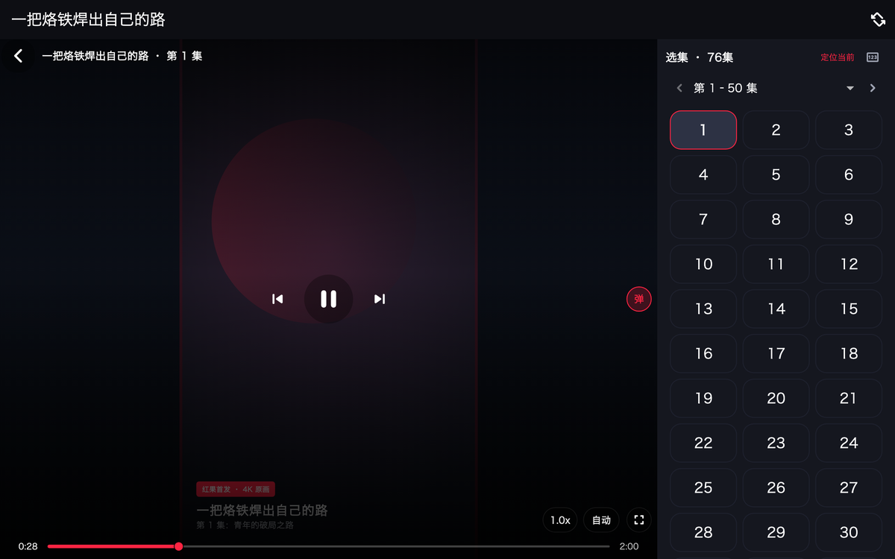 | 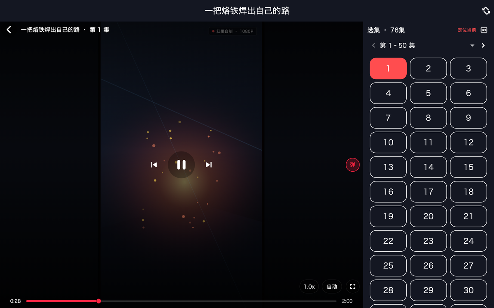 |

### 📱 移动端 (iOS / Android)

| 首页发现与分类 | 搜索与关键词联想 | 热播短剧排行榜 |
| :---: | :---: | :---: |
| 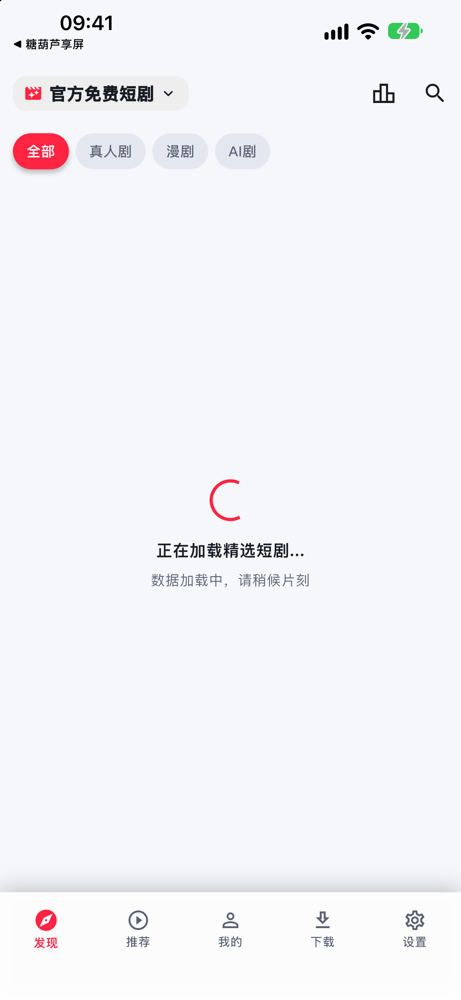 | 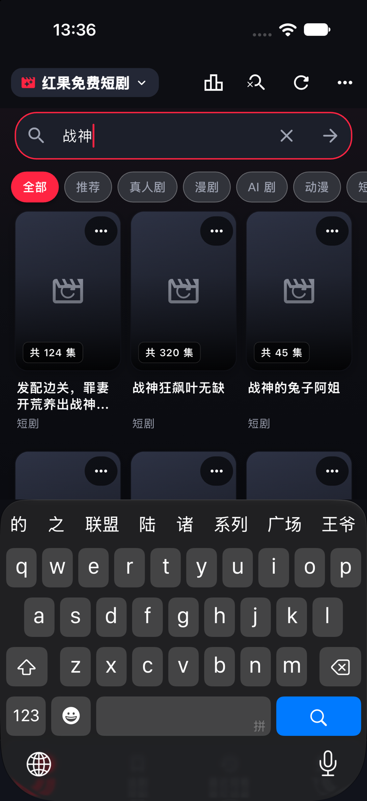 | 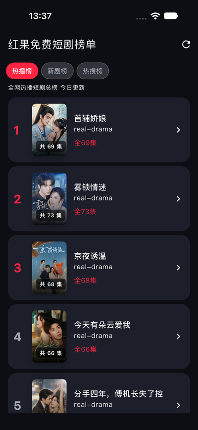 |

| 剧集详情与选集 | 竖屏沉浸式播放 | 横屏全屏影院模式 |
| :---: | :---: | :---: |
| 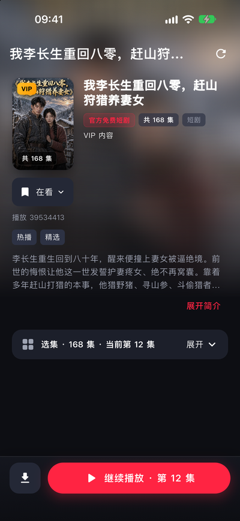 | 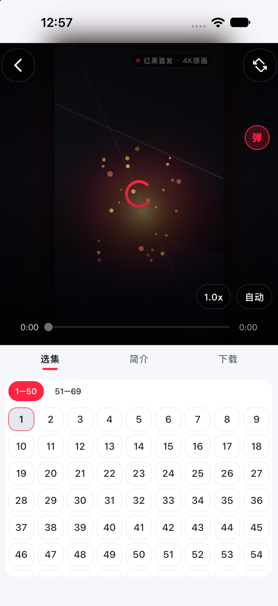 | 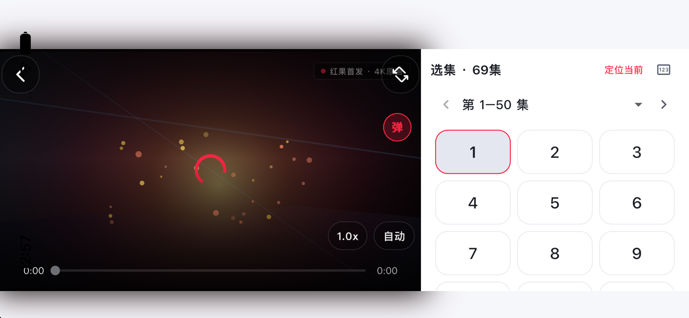 |

### 🔴 鸿蒙原生端 (HarmonyOS NEXT)

| 鸿蒙端首页与流式分页 | 鸿蒙端短剧选集与沉浸播放 |
| :---: | :---: |
| 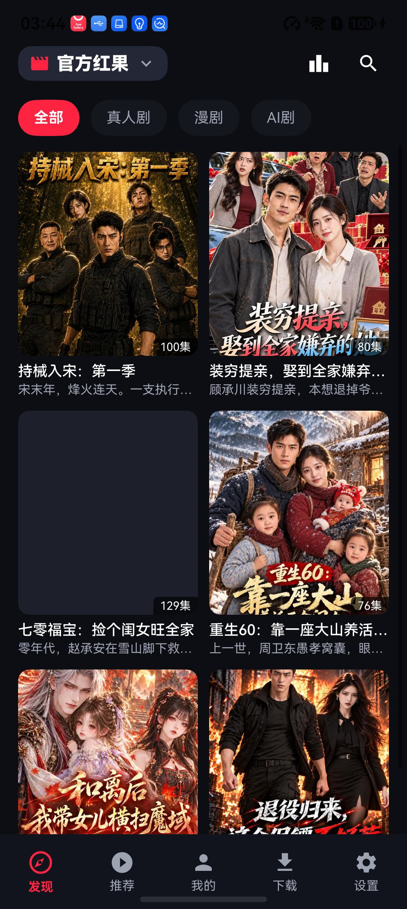 | 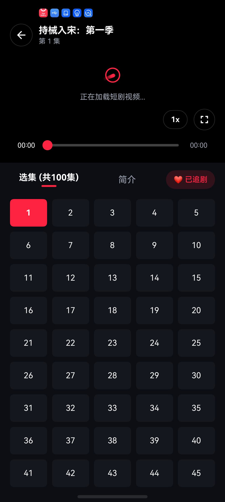 |

### 📺 客厅大屏端 (Apple tvOS)

| tvOS 首页瀑布流 | tvOS 剧集详情与选集 |
| :---: | :---: |
| 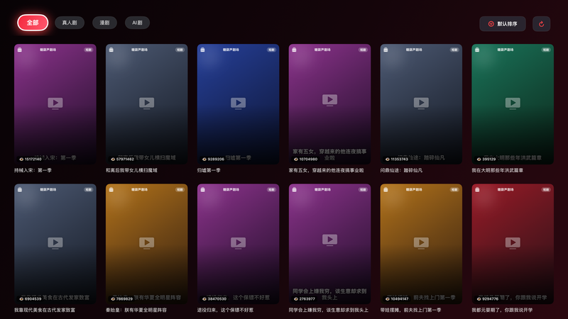 | 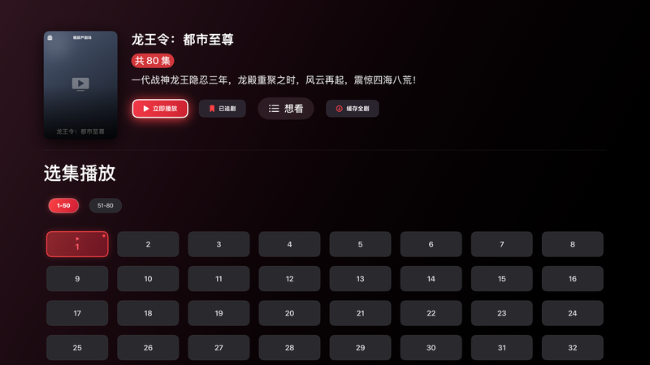 |

| tvOS 热播排行榜 | tvOS 全屏播放与控制层 |
| :---: | :---: |
| 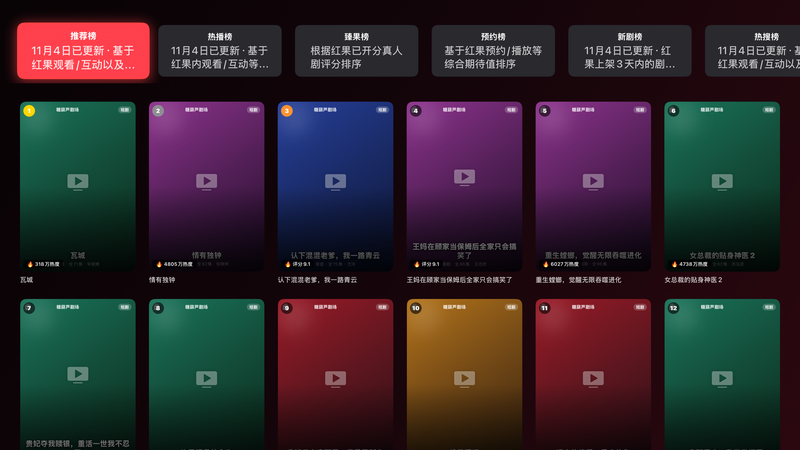 | 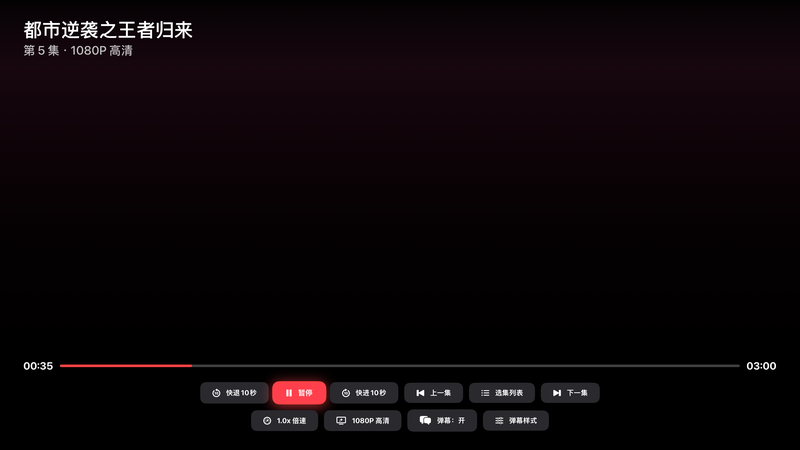 |

---

## 平台支持矩阵

| 平台 | 架构与特性 | 交付产物 |
| :--- | :--- | :--- |
| **Android / Android TV** | 适配手机、折叠屏与电视大屏，支持竖屏滑动手势、画中画（PiP）浮窗与遥控器焦点导航 | 原生 Flutter + NDK，输出 APK / AAB |
| **iOS / iPadOS** | 原生画中画（PiP）、后台续播、深色模式自适应、双屏折叠设备适配与 iCloud 进度同步 | 支持 TestFlight 一键安装 / IPA |
| **HarmonyOS NEXT** | 华为纯血鸿蒙原生工程（`harmonyos/`），纯 ArkTS + ArkUI 架构，集成 OpenSSL CENC 硬件级流式解密与 AVPlayer 硬解 | 签名 HAP 安装包 |
| **Apple tvOS** | 独立原生大屏工程（`tvos/`），SwiftUI + Siri Remote 焦点引擎 + AVKit 原生渲染 | 独立 Xcode 工程，输出 tvOS IPA |
| **Windows / macOS** | 桌面端大屏自适应分栏视窗，支持 libmpv 硬件解码与键盘方向键快捷操作 | 免安装绿色便携包 / PKG |

---

## 核心功能

- 📺 **全端硬件级解码**：iOS / tvOS / HarmonyOS 原生支持加密短剧边下边解流式播放，多清晰度自适应切换、实时弹幕与连播预加载。
- 📱 **多端手势与画中画**：手机竖屏上下滑换集、长按 3 倍速快进；横屏手势精准调节音量/亮度/进度；支持 iOS 与 Android 系统级画中画（PiP）小窗后台接续。
- 🔍 **分类检索与无限分页**：真人剧、漫剧、AI短剧多分类无缝切换；触底流式无限分页；支持实时联想搜索与本地历史管理。
- 🎬 **剧集详情与多季聚合**：官方系列多季短剧智能聚合展示与快速选集，正序/倒序轻松切换。
- 🗂️ **本地追剧与断点续播**：纯端侧保存追剧收藏，秒级断点续播，支持最近观看记录管理。
- 🔒 **隐私保护与专属空间**：内置九宫格图形手势锁屏、后台多任务防窥虚化及独立私密短剧库。

---

## 构建说明

### Flutter 客户端 (Android / iOS / Windows / macOS)

```bash
# 获取依赖与启动运行
fvm flutter pub get
fvm flutter run

# 构建 Windows x64 发布包 (产物位于 build/windows/x64/runner/Release/)
fvm flutter build windows --release
```

### 鸿蒙原生端 (HarmonyOS NEXT)

```bash
cd harmonyos

# 执行构建并输出签名 HAP (产物位于 entry/build/default/outputs/default/entry-default-signed.hap)
hvigorw --mode module -p module=entry@default -p product=default assembleHap
```

### Apple tvOS 原生端

```bash
cd tvos

# 打开 Xcode 编译或使用 fastlane 打包
open THLRedLook.xcodeproj
```

---

## 📈 Star 历史趋势

<a href="https://star-history.com/#never88gone/THLRedGuo&Date">
 <picture>
   <source media="(prefers-color-scheme: dark)" srcset="https://api.star-history.com/svg?repos=never88gone/THLRedGuo&type=Date&theme=dark" />
   <source media="(prefers-color-scheme: light)" srcset="https://api.star-history.com/svg?repos=never88gone/THLRedGuo&type=Date" />
   
 </picture>
</a>
