# 糖葫芦Haw (THLRedLook)

<p align="left">
  <a href="https://github.com/never88gone/THLRedGuo/stargazers"></a>
  <a href="https://github.com/never88gone/THLRedGuo/network/members"></a>
  
  <a href="https://flutter.dev"></a>
  <a href="https://testflight.apple.com/join/rkvvdp7J"></a>
  <a href="https://t.me/tanghulutvos"></a>
</p>

> ⚠️ **免责声明 (Disclaimer)**：
> 1. **仅供学习研究**：本项目仅供编程技术交流、Flutter 跨平台与 Apple tvOS 原生应用架构研究使用，严禁用于任何商业牟利或侵权用途；
> 2. **纯客户端工具，无内容存储**：本项目为纯本地端侧播放器工具，无需注册登录即可直接使用；开发者不搭建、不运营任何流媒体服务器，不提供、不存储、不分发任何音视频资源；
> 3. **网络数据版权归属**：应用中所有可访问的数据源均来源于第三方网络公开平台，其版权与知识产权均归原版权方所有，请自觉支持正版内容；
> 4. **责任限制**：用户使用本软件及自配数据源产生的一切法律责任及版权纠纷均由使用者自行承担，与本项目及其代码贡献者无关。

**糖葫芦Haw**（工程标识：`THLRedLook`，包名 / Application ID：`com.never88gone.redlook`）是一款基于 **Flutter + Apple tvOS 原生** 打造的全平台独立流媒体与短剧聚合应用。

应用内无需注册任何账号、无需登录，打开即用。数据解析、高清播放、弹幕呈现与离线下载均在设备本地端侧闭环完成，无需搭建任何远程中转或中心化代理服务，带来极速的启动体验、数据私密性与全平台一致的使用感受。

---

## 📲 官方公测与交流反馈

- **🍏 Apple TestFlight 官方公测**：[立即加入 TestFlight 公测 (iOS / iPadOS / tvOS)](https://testflight.apple.com/join/rkvvdp7J)
  > 覆盖 iOS (iPhone / iPad) 与 Apple tvOS 客厅大屏版，点击链接即可通过苹果官方 TestFlight 一键安装并接收版本更新。
- **💬 Telegram 官方交流与反馈**：[https://t.me/tanghulutvos](https://t.me/tanghulutvos) （频道 / 群组：`@tanghulutvos`）
  > 欢迎加入 Telegram 官方交流群获取最新动态、交流反馈与建议。

---

## 界面预览

### 🖥️ 桌面端宽屏与分栏视窗 (Windows / macOS)

| 桌面端宽屏分栏全景 | 桌面端高清播放与选集 |
| :---: | :---: |
| 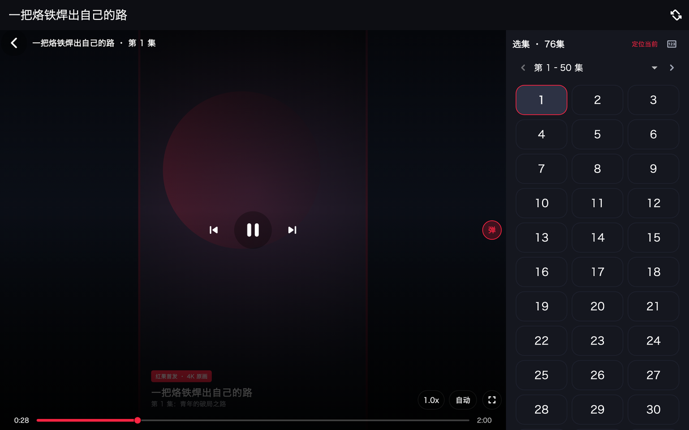 | 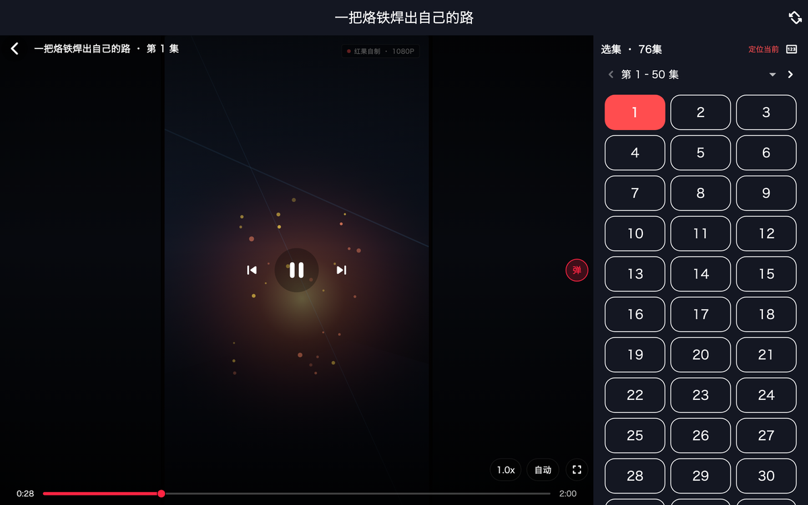 |

### 📱 移动端核心观影体验 (iOS / Android)

| 首页发现与分类 | 搜索与关键词联想 | 热播短剧排行榜 |
| :---: | :---: | :---: |
| 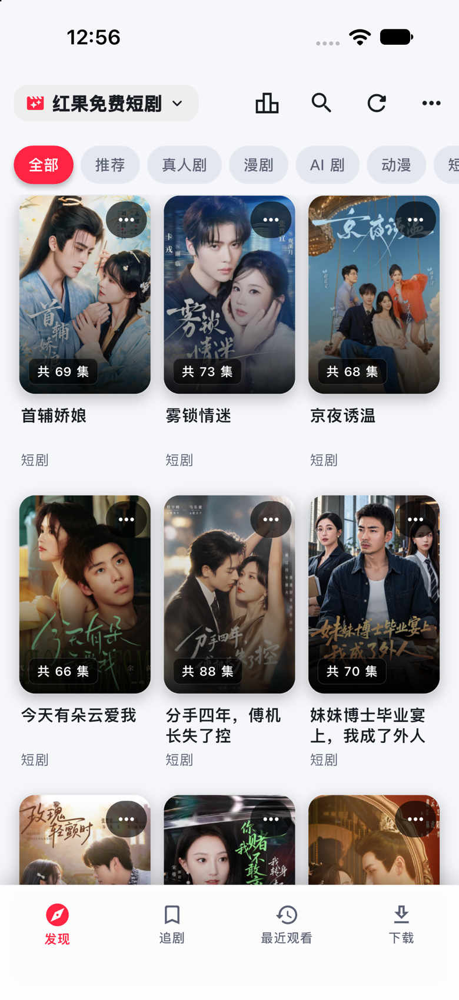 | 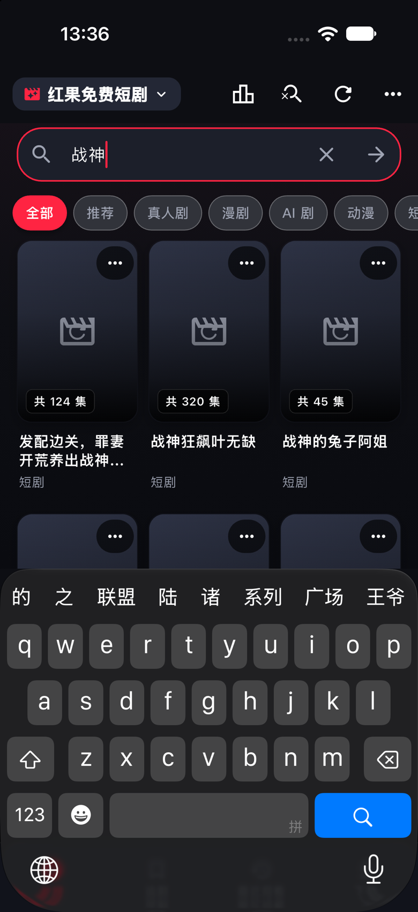 | 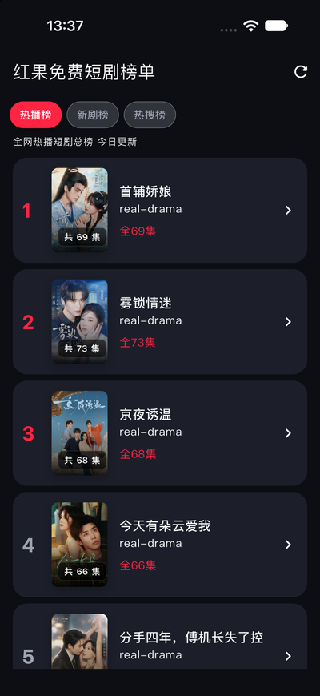 |

| 剧集详情与选集 | 竖屏沉浸式播放 | 横屏全屏影院模式 |
| :---: | :---: | :---: |
| 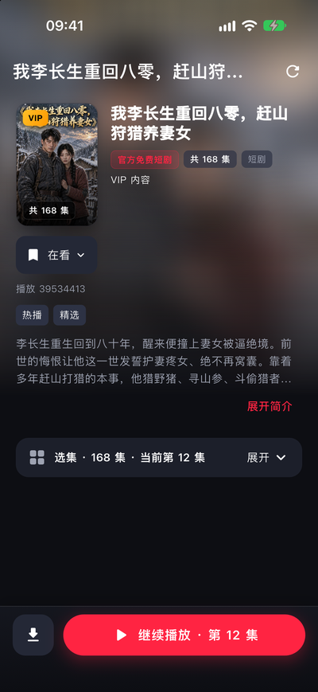 | 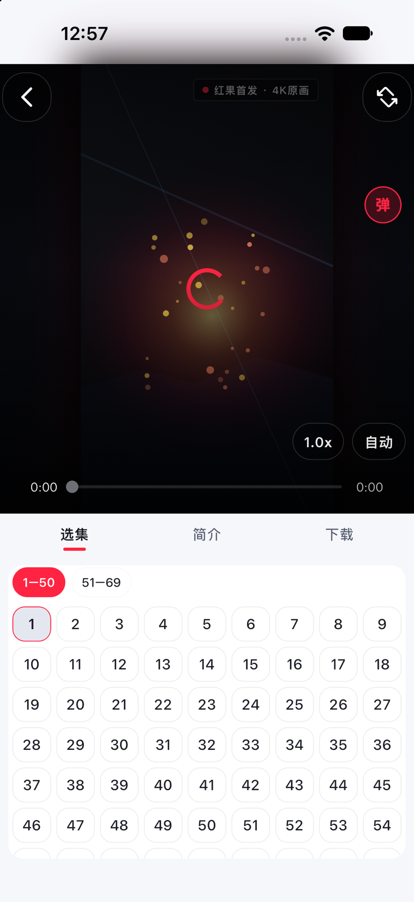 | 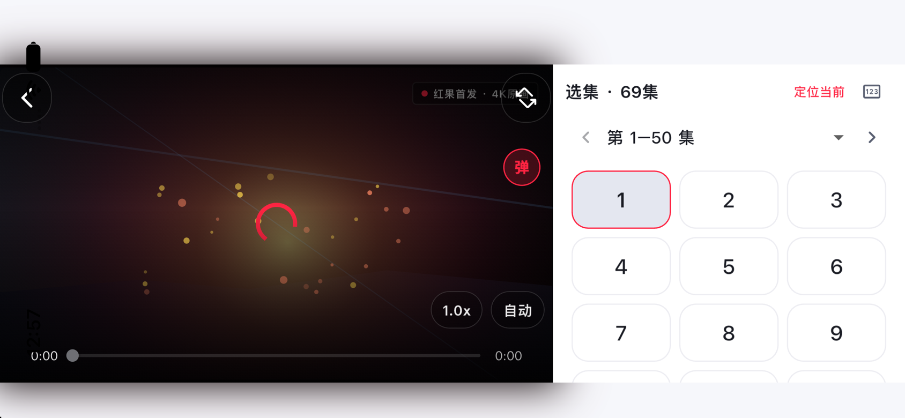 |

### 🗂️ 追剧、历史、离线缓存与插件管理

| 我的追剧收藏 | 最近观看 | 离线下载管理 | JS 数据源插件管理 |
| :---: | :---: | :---: | :---: |
| 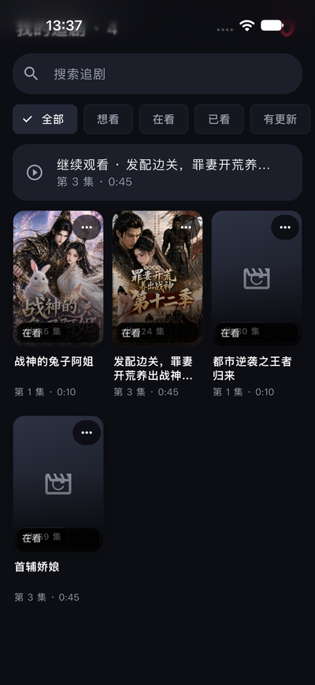 | 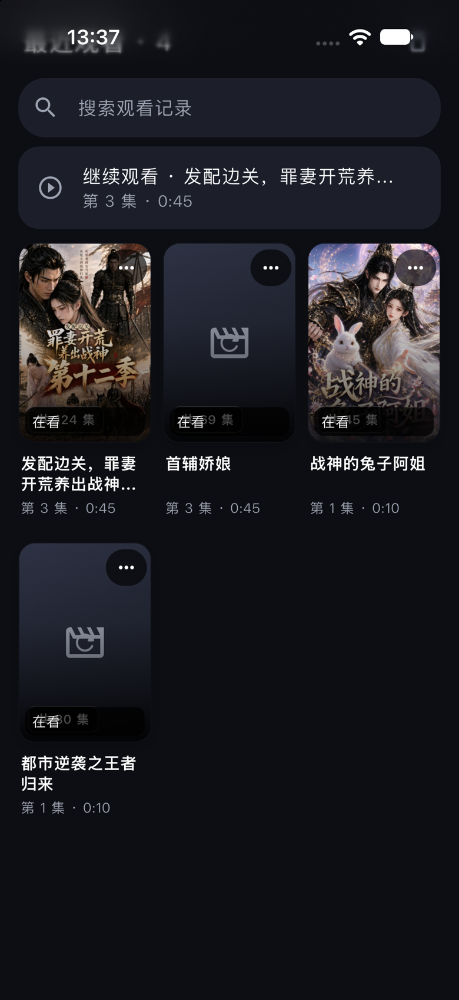 | 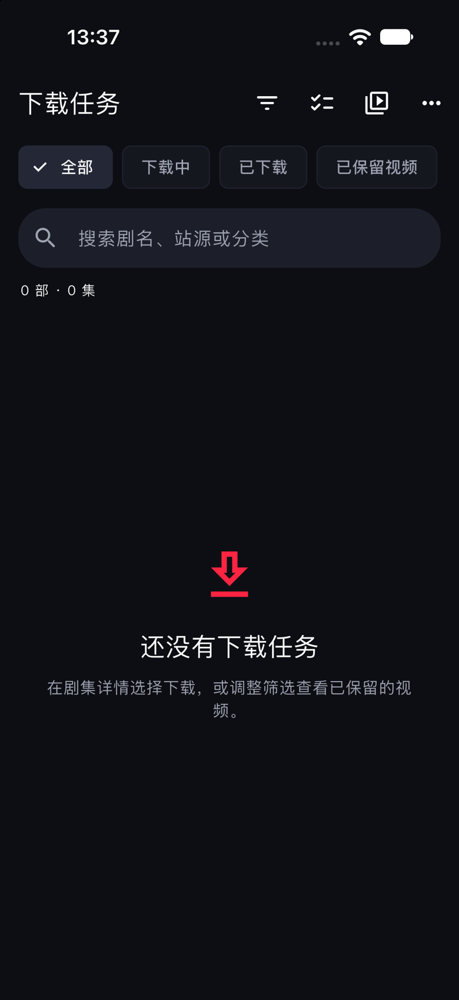 | 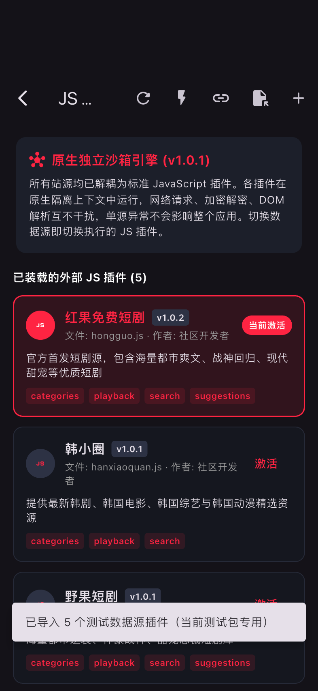 |

### 🔒 隐私安全与私密保险箱

| 九宫格手势锁 | 隐私模式与私密设置 | 独立私密短剧库 |
| :---: | :---: | :---: |
| 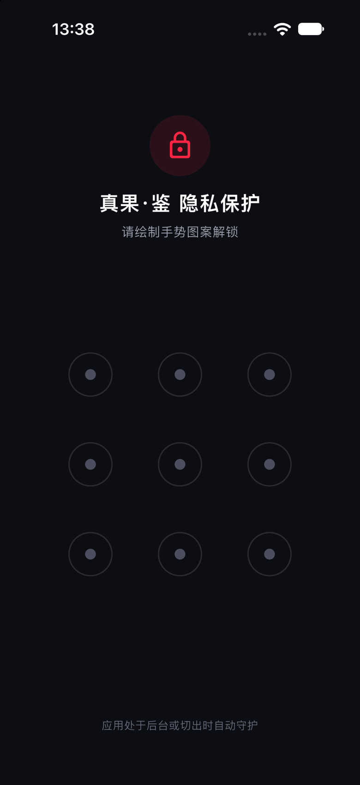 | 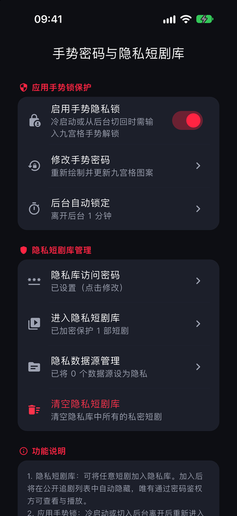 | 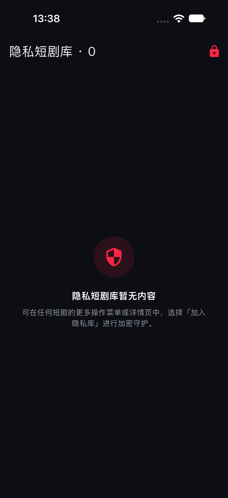 |

### 📺 Apple tvOS 客厅大屏原生端

| tvOS 首页瀑布流 | tvOS 剧集详情与选集 |
| :---: | :---: |
| 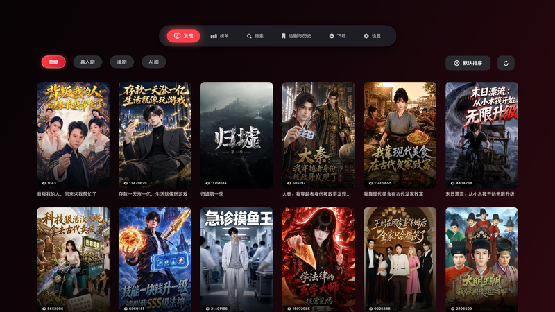 | 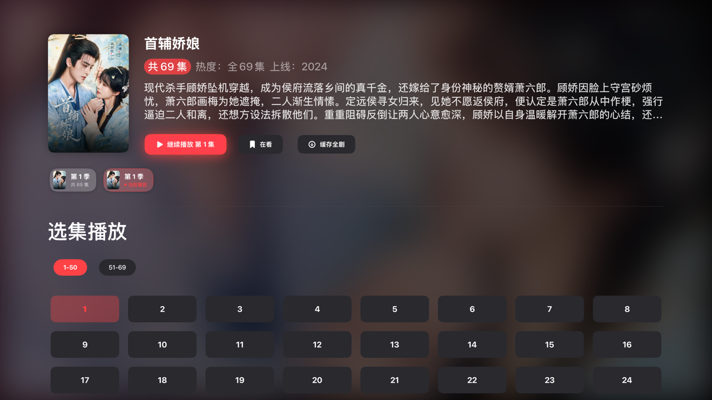 |

| tvOS 热播排行榜 | tvOS 全屏播放与控制层 |
| :---: | :---: |
| 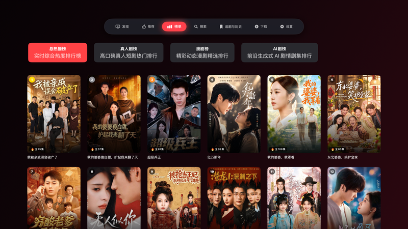 | 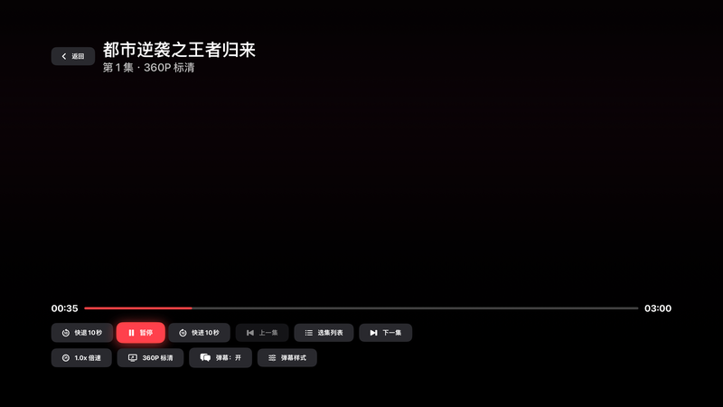 |

---

## 平台支持矩阵

应用深度适配移动端、桌面端与客厅大屏，覆盖以下操作系统与形态：

| 平台 | 形态与特性 | 构建与交付产物 |
| :--- | :--- | :--- |
| **Android** | 适配手机、折叠屏与老旧设备，兼容 Android 7.1+（API 25+），支持竖屏短剧滑动手势、画中画（PiP）浮窗、arm64-v8a / armeabi-v7a / x86_64 三架构 | 原生 Flutter + NDK 编译，输出 APK / AAB |
| **Android TV** | 自动识别大屏电视模式，锁定横屏影院布局，完整适配遥控器方向键与焦点移动 | 共用 Flutter 源码，自适应电视 UI 布局 |
| **iOS** | 适配 iPhone / iPad，原生画中画（PiP）小窗播放与后台接续、深色模式自适应、原生手势返回与低功耗下载 | Xcode 编译签名，输出 IPA 归档；支持 [Apple TestFlight](https://testflight.apple.com/join/rkvvdp7J) 一键安装 |
| **macOS** | 桌面端大屏响应式三栏/分栏布局，键盘方向键与快捷键全面支持 | macOS App / PKG 安装包 |
| **Windows** | 基于 `media_kit` / libmpv 硬件解码，集成专属 Shader 画质增强滤镜 | 独立免安装绿色包 / 便携目录（含完整 DLL 与运行环境） |
| **Apple tvOS** | 独立原生工程（`tvos/`），纯 SwiftUI + Siri Remote 焦点引擎 + AVKit 原生渲染打造，具备完整客厅大屏交互与原生影院体验 | 独立 Xcode 工程，输出 tvOS IPA；支持 [Apple TestFlight](https://testflight.apple.com/join/rkvvdp7J) 一键安装 |

---

## 核心功能介绍

### 📺 首页探索与热播排行
- **发现页（Flutter / tvOS）**：直接读取红果手机 App「找剧」的全部、真人剧、漫剧、AI剧分类与数据；瀑布流滚动自动加载下一页，失败后可重试；
- **手机版短剧榜单**：读取手机 App 返回的总榜与真人剧、漫剧、AI 剧分类榜，保留官方排序和指标。

### 🔍 智能搜索与联想
- **手机版搜索与联想**：使用红果手机 App 搜索接口，支持游标分页；空输入展示官方“猜你想搜”，输入关键字展示官方搜索联想；
- **本地搜索历史**：自动记录搜索词，支持一键点击历史词快捷重新检索或清理历史。

### 🎬 剧集详情与系列多季
- **海报大图与高清全屏预览**：剧集海报呈现放大至舒适比例，支持点击海报调起全屏查看与双指缩放；
- **紧凑布局与多状态追剧**：标签移至海报右侧紧凑对齐，支持「想看 / 在看 / 已看」多档追剧状态底部弹窗管理；
- **防眩光沉浸对比度**：采用多重深度渐变遮罩与独立半透明底衬，彻底消除背景海报高光对剧情简介和播放量的眩光干扰；
- **系列多季聚拢展示**：优先使用官方系列剧接口按官方季号展示与切换，未上线季智能标识，接口不可用时平滑回退搜索关联。

### ⚡ 影院级视听与播放控制
- **系统级画中画 (PiP) 浮窗观影**：支持 iOS 与 Android 系统级原生画中画小窗播放，切出应用不中断观影，点击浮窗秒级还原跳转回播放器页面；
- **沉浸式视频流推荐与无限翻页**：满宽贴底进度条直达屏幕边缘，去除多余按钮与翻页阻断，支持上下滑动平滑无限轮转切剧；
- **iOS 加密短剧流式播放**：支持边加载边解密流式播放、平滑拖拽与连续切集，针对弱网与格式异常具备多级自愈机制；
- **清晰度智能与手动切换**：默认优先播放可用的 1080P，片源不可用时回退到其他实际档位；清晰度菜单显示当前分集返回的档位，手动切换保留播放进度；
- **实时弹幕互动**：弹幕随播放时间轴滚动渲染，支持在播放菜单中随时开启或关闭弹幕；
- **多种播放手势与偏好**：
  - **手机竖屏**：手指上下滑动快速换集，长按屏幕任意位置触发 3 倍速快进，轻点启停；
  - **横屏模式**：屏幕左侧上下滑动调节亮度，右侧上下滑动调节音量，左右滑动快进/后退；
  - **连播与预热**：支持在播放菜单中自由开启或关闭“自动连播”；开启下一集预加载，片尾秒开切集；
- **统一全景选集浮层**：弹出浮层支持多季切换、正序/倒序排列与完整平滑滚动，横屏播放下选集顺畅不遮挡。

### 🗂️ 我的追剧与播放历史
- **一键追剧收藏**：在详情页或播放器中点击“加入追剧”即可收藏，方便随时回看；
- **精准断点续播**：自动记录每部短剧的观看集数与秒级进度，下次打开即刻无缝续播；
- **播放历史管理**：提供独立的“最近观看”页面，支持单条滑动删除或一键清空历史记录。

### 📥 离线缓存与分集下载
- **分集多选批量下载**：在短剧详情页支持批量勾选剧集并一键加入下载队列；
- **断点续传与离线播放**：下载过程网络波动自动恢复断点，下载完成后无需网络流量即可离线完整观看；
- **下载常亮防息屏**：提供下载时屏幕常亮开关，防止设备息屏导致批量下载挂起。

### 🔒 隐私安全与私密空间
- **九宫格图形手势锁**：支持在设置中开启九宫格锁屏密码，应用切至后台自动加锁防窥；
- **多任务防窥虚化**：切换应用或打开多任务栏时，画面自动触发高斯模糊遮罩；
- **独立私密短剧空间**：提供独立加密的私密空间，私密剧集与专属记录独立存放，不进入常规播放列表。

### ⚙️ 数据源管理与网络诊断
- **数据源插件管理**：在设置页面可查看当前已启用的数据源，支持长按或点击删除自定义数据源并带有二次确认；
- **tvOS 数据源版本核对**：设置 → 站源管理显示应用构建号、内置 JS 指纹与运行一致性；完整诊断日志包含源提交和各运行上下文指纹，便于确认安装包和实际执行的 JS。
- **网络状态一键诊断**：设置页提供网络检测与诊断工具，可查看与当前数据源的网络连接状态并一键复制完整脱敏排查报告。
- **出口 IP 与地区**：数据源诊断页及导出报告显示查询服务看到的出口 IP、估算归属地区、来源和检测时间。查询使用 IP.SB / IPWho.is，不读取 GPS；代理分流时可能与红果接口的出口不同，归属地区不能单独证明风控原因。
- **诊断日志导出**：Flutter 支持导出完整脱敏文本日志，iOS 可通过系统分享面板存储到“文件”或手动反馈。tvOS 可由同一局域网内的手机扫码复制或下载日志，关闭二维码页面后链接失效，最长有效 10 分钟。日志不会自动上传。

---

## 目录结构概览

```
THLRedLook
├── lib/                   # Flutter 跨平台业务逻辑、页面 UI、播放器控制器与端侧调度
├── android/               # Android 原生平台工程与清单配置
├── ios/                   # iOS 原生平台工程、Podfile 与签名配置
├── macos/                 # macOS 桌面端平台工程与权限配置
├── windows/               # Windows 桌面端 Runner 与 CMake 构建系统
├── tvos/                  # Apple tvOS 原生独立工程（SwiftUI + AVKit + Focus Engine）
└── scripts/               # 工程工具链与辅助脚本
```

---

## 开发与本地构建

### 环境准备
- **Flutter SDK**：3.44.x+（推荐使用 `fvm`）
- **Python**：3.10+（用于运行工程工具链脚本）
- **平台依赖**：
  - Android：JDK 17+、Android SDK 36
  - iOS / macOS / tvOS：macOS 系统、Xcode 16+、CocoaPods
  - Windows：Visual Studio 2022 C++ 桌面开发套件

### 运行与调试
本项目零服务器配置依赖，一键拉取依赖即可运行：

```bash
# 获取 Flutter 依赖
flutter pub get

# 启动本地调试（全平台支持）
flutter run
```

---

## 📈 Star 历史趋势 (Star History)

<a href="https://star-history.com/#never88gone/THLRedGuo&Date">
 <picture>
   <source media="(prefers-color-scheme: dark)" srcset="https://api.star-history.com/svg?repos=never88gone/THLRedGuo&type=Date&theme=dark" />
   <source media="(prefers-color-scheme: light)" srcset="https://api.star-history.com/svg?repos=never88gone/THLRedGuo&type=Date" />
   
 </picture>
</a>

